# 面向 AI Coding 的企业级知识库可审计决策方案

> 本文围绕知识体系的**核心生命周期**组织：生成 → 验证 → 审批 → 存储 → 检索 → 维护 → 评测。每个阶段包含标准、实施方式和度量方法。原有决策保留编号，嵌入对应阶段。

## 1. 证据与置信度说明

### 1.1 依据性质

- **直接依据**：标准、规范或官方文档明确规定或描述了相关要求、能力，且规定内容与本方案的该条设计**逐项对应**。
- **方向性依据**：权威来源支持该设计的**必要性与方向**，但未规定具体结构、顺序或取值。引用此类来源时不得声称"标准如此要求"。
- **工程推导**：由一个或多个可信来源组合形成的落地方案，不代表来源逐字规定了该架构。
- **自拟**：本方案提出的结构，无外部来源，其有效性只能通过 §9 评测体系自证。

> 引用纪律：一个来源只在它真正支持该条结论时列出。**挂名式引用（列一个权威链接但它并不支持该设计）会稀释整套标注体系的可信度**——评审者一旦发现一处挂名，就会怀疑全部依据。因此本文对每条依据标注性质，性质为「方向性依据」或「自拟」的条目不得作为验收依据使用。

### 1.2 置信度

- **高**：标准、安全组织、正式规范或多个官方来源交叉支持。
- **中高**：单一官方工程实践或产品能力支持，仍需结合企业环境验证。
- **待实测**：阈值、规模和参数必须通过本团队语料、系统和业务场景评测确定。

### 1.3 度量目标值的性质标注

各章「度量」小节中的每一个目标值都带**性质**列，取值三类：

| 性质         | 含义                                                                                   | 是否可作验收门禁 |
| ------------ | -------------------------------------------------------------------------------------- | ---------------- |
| **机制保证** | 由设计机制强制成立（如系统生成引用 ID 后校验拦截），不是对模型或人的行为假设             | 是，可硬门禁     |
| **阈值待实测** | 指标概念有权威来源，但**具体数值是本方案的初始建议值**，须按 §14 校准后才可作为门禁     | 否，校准前仅观测 |
| **趋势指标** | 不设绝对阈值，只看环比方向                                                               | 否               |

> 这一节是对 §1.2「待实测」档的落地约束：**凡是没有外部权威数值来源的阈值，一律标注为「阈值待实测」，不得以既成事实的口吻写成验收线。**

---

## 2. 知识生命周期总览

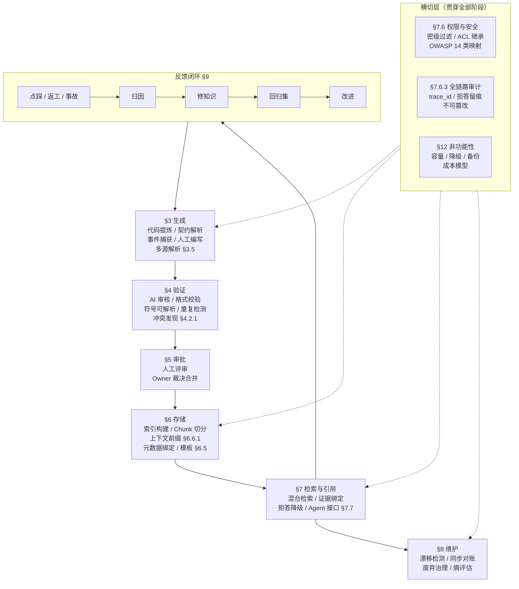

**核心原则**：仓库是唯一事实源（[OpenAI Harness Engineering](https://openai.com/index/harness-engineering/)）。散落在 Slack、Confluence、IM 中的知识对 Agent 不可见，必须入库。

**横切层不是可选增强**：权限过滤（§7.6）属于 L0 能力，审计（§7.6.3）是评测与事故归因的数据来源，非功能性设计（§12）决定 P0 能否落地。三者缺失时，前六个阶段的产出都不可信或不可运维。

---

## 3. 知识生成

> 本阶段解决：知识从哪里来？怎么产生？产生什么格式？

### 3.1 权威事实源（决策 2）

为每类知识指定权威事实源，知识条目必须绑定到具体源文件：

| 知识类型  | 建议权威源                               |
| --------- | ---------------------------------------- |
| HTTP 接口 | OpenAPI 和当前发布实现                   |
| RPC 接口  | Java Interface、Proto、IDL               |
| 表结构    | Flyway/Liquibase Migration 和实际 Schema |
| 配置项    | 配置中心声明或配置 Schema                |
| 架构规则  | 已审批 ADR 和可执行架构测试              |
| 业务规则  | 已审批需求、状态机、领域规则             |
| 生产状态  | 发布、监控、配置等实时平台               |
| 组织权限  | IAM、SSO、团队系统                       |
| 设计背景  | 已审批设计文档和评审结论                 |

**依据**：[OpenAPI](https://spec.openapis.org/oas/v3.1.2)、[Flyway](https://documentation.red-gate.com/flyway/flyway-concepts/migrations/flyway-schema-history-table)、[Backstage](https://backstage.io/docs/features/software-catalog/system-model/)、[OpenAI Harness](https://openai.com/index/harness-engineering/)

**性质**：工程推导 | **置信度**：高

### 3.2 知识产生路径

| 触发源 | 提取方式 | 产出格式 | 实施方法 |
|--------|----------|----------|----------|
| **代码实现** | AI 从代码提炼业务逻辑、设计决策、约束条件 | 知识草稿（`status: draft`） | 定期扫描核心模块，AI 生成候选知识条目 |
| **接口契约** | 自动解析 OpenAPI/Proto/Migration 变更 | 结构化草稿 | CI 检测契约文件变更时自动生成/更新知识 |
| **事故/值班** | AI 提取候选事实、决策、原因和反例 | 隐性知识显性化草稿 | 事故复盘后由 AI 辅助生成 IncidentLesson |
| **MR/PR 讨论** | 捕获评审中的设计决策和权衡 | 决策记录草稿 | MR 合并时提取 review comments 中的决策 |
| **规范/制度** | 人工编写或 AI 辅助结构化 | 正式知识条目 | 领域专家直接撰写 |
| **IM/会议** | AI 提取候选事实，绑定原始证据 | 草稿（需人工确认） | 会议纪要 → AI 提取 → Owner 审批 |

### 3.3 隐性知识提取（决策 6）

隐性知识只能提取为草稿，不能自动确权：

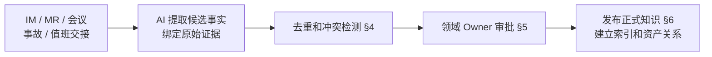

知识类型：Concept、Decision、Policy、Procedure、Contract、FAQ、IncidentLesson。

**依据**：[NIST AI RMF Govern](https://airc.nist.gov/airmf-resources/playbook/govern/)、[DataHub Glossary](https://docs.datahub.com/docs/features/feature-guides/business-glossary/)、[OpenAI Harness](https://openai.com/index/harness-engineering/)、[OWASP RAG Security](https://cheatsheetseries.owasp.org/cheatsheets/RAG_Security_Cheat_Sheet.html)

**性质**：工程推导 | **置信度**：高

### 3.4 知识条目标准

每条知识必须包含：

| 要素 | 要求 | 说明 |
|------|------|------|
| **背景** | 必须 | 为什么需要这条知识？解决什么问题？ |
| **方案** | 必须 | 技术方案描述，引用具体代码位置 |
| **正反例** | 必须 | 正确做法 + 错误做法 + 解释为什么 |
| **权威源绑定** | 必须 | source_uri + source_revision |
| **Owner** | 必须 | owner_group 明确责任团队 |
| **适用范围** | 建议 | 涉及哪些模块、服务、API |

### 3.5 多源解析与预处理（决策 25）

> 前面各节假设知识已经以规范 Markdown 存在于仓库。但企业存量知识大量分布在 Confluence、Wiki、IM、PDF、Office 文档和截图中，**这一层不做，「仓库是唯一事实源」就只是口号**——存量知识进不来，知识库只能覆盖新增部分。

#### 3.5.1 各来源的解析方式与产物

| 来源 | 解析方式 | 产物 | 增量同步机制 | 主要失真风险 |
| ---- | -------- | ---- | ------------ | ------------ |
| Git 仓库 Markdown | 直接读取，无需转换 | 原文 + frontmatter | Webhook / `git diff` | 无 |
| Confluence / Wiki | 官方 REST API 导出 storage format（XHTML），再转 Markdown | Markdown + 页面版本号 | API 的 `version.number` 比对 | 宏（macro）、附件、页面树层级丢失 |
| 语雀 / 飞书文档 / 钉钉文档 | 各自开放平台 API 导出（语雀支持 Markdown/Lake，飞书为 block 结构 JSON 需自行转 Markdown） | Markdown + 文档版本号 | API 的版本号或 `edited_time` 比对 | 飞书 block 转 Markdown 会丢失多维表格、思维笔记等非文档类型；权限模型与知识库 ACL 需二次映射（§7.6.1） |
| PDF | 版面解析（保留标题层级与阅读顺序），表格单独抽取 | Markdown + 页码锚点 | 文件内容 hash | **表格与多栏版面极易错序**，扫描件需 OCR |
| Office（Word/Excel/PPT） | 转 Markdown；Excel 表格转 Markdown 表或结构化数据 | Markdown | 文件内容 hash | 公式、图表、批注丢失 |
| IM / 会议记录 | AI 提取候选事实 + 绑定原始消息链接 | 草稿（`status: draft`） | 消息 ID 单调递增 | 断章取义、上下文缺失 |
| 截图 / 架构图 | OCR + 图像理解，产出文字描述 | 描述文本 + 原图引用 | 文件内容 hash | 图中文字与连线关系可能误读 |

#### 3.5.2 解析必须保留的结构

以下四类结构一旦在解析中丢失，下游检索质量会系统性下降，**必须作为解析器的验收项**：

1. **标题层级**：切分依赖 H2/H3 语义边界（§6.4）。层级被压平后，chunk 边界退化为定长切分，`section_anchor`（§7.4）也随之失效。
2. **表格**：表格是契约类知识的主要载体。必须转为 Markdown 表或结构化 JSON，**不得转成一段连续文本**——否则「字段名 → 类型 → 约束」的对应关系被打散，检索到也无法使用。
3. **代码块**：保留语言标注与原始缩进。代码块内的空格与大小写**不得规范化**（否则示例失效）。
4. **图片与附件**：保留原始 URI 与 alt 文本。图片本身不入向量索引，但其 alt / 图注文字应入库并可检索。

#### 3.5.3 解析失败的处置（Fail-Closed）

解析是外部输入进入知识库的第一道边界，**必须 fail-closed，不得静默降级**：

| 失败类型 | 处置 | 是否入库 |
| -------- | ---- | -------- |
| 解析器抛异常 / 超时 | 记录 `parse_failed`，告警 Owner，保留原文引用 | 否 |
| 解析成功但标题层级为 0（全文无标题） | 标记 `structure_degraded`，进入人工确认队列 | 否，待人工 |
| 表格转换后单元格丢失率超阈值 | 标记 `table_degraded`，附原文件链接 | 是，但检索结果必须附带「表格可能失真」提示 |
| OCR 置信度低于阈值 | 标记 `ocr_uncertain`，仅索引高置信度片段 | 部分 |

**为什么不允许「解析不出来就整篇塞进去」**：一篇结构丢失的长文档进入索引后，会在向量检索中形成大面积低质量召回，**挤占 Top-K 名额**，使正确证据反而落榜（直接拉低 Recall@K）。宁可不入库，也不入劣质库。

#### 3.5.4 非 Markdown 来源的权威源绑定

§6.2 的 `source_uri` 以 `gitlab://` 为范式。外部来源需要各自的 URI 方案，且**必须能定位到具体版本**，否则漂移检测（§8.4）无法工作：

```text
confluence://{spaceKey}/{pageId}?version={n}
wiki://{space}/{pageId}?revision={rev}
yuque://{namespace}/{slug}?version={n}
feishu://{docToken}?revision={rev}
sharepoint://{site}/{itemId}?etag={etag}
file://{sha256}                      # 无版本系统的二进制文件，用内容 hash 充当版本
im://{workspace}/{channelId}/{messageTs}
```

`file://{sha256}` 是关键设计：PDF / Office 文件没有 commit 概念，**用内容 hash 作为版本标识**，使「文件是否变更」仍可被对账任务判定。代价是无法做语义 diff，只能整篇重新解析——这是可接受的，因为这类文档变更频率远低于代码。

**依据**：[Confluence REST API](https://developer.atlassian.com/cloud/confluence/rest/v2/intro/)、[OWASP RAG Security](https://cheatsheetseries.owasp.org/cheatsheets/RAG_Security_Cheat_Sheet.html)（Supply Chain Risk in Ingestion、Document Poisoning，映射见 §7.6）、[AWS Bedrock 数据源同步](https://docs.aws.amazon.com/bedrock/latest/userguide/kb-data-source-sync-ingest.html)

**性质**：URI 方案与 fail-closed 处置表为自拟；「解析失败不得静默降级」有直接依据（OWASP Fail-Closed Design） | **置信度**：高（处置原则）/ 自拟（具体阈值）
**待实测**：表格单元格丢失率阈值、OCR 置信度阈值、各解析器的超时与重试参数。

### 3.6 度量

| 指标 | 计算方式 | 目标 | 性质（§1.3） |
| ---- | -------- | ---- | ------------ |
| 知识识别覆盖率 | 已有知识条目覆盖的模块数 / 总活跃模块数 | ≥ 80% | 阈值待实测 |
| 种子知识完成率 | 核心模块种子知识条数 / 计划条数 | 100% | 机制保证（计划条数由本团队定义，完成与否可直接判定） |
| 隐性知识转化率 | 从草稿到 active 的条目数 / 生成草稿总数 | ≥ 40% | 阈值待实测 |
| 解析成功率 | 成功解析并入库的源文档数 / 尝试解析的源文档数 | ≥ 95% | 阈值待实测 |
| 结构保真率 | 解析后标题层级与表格数量与原文一致的比例 | ≥ 90% | 阈值待实测 |

---

## 4. 知识验证

> 本阶段解决：知识条目在提交后、人工审核前，经过哪些自动化质量门控？

### 4.1 重复治理（决策 5）

重复治理采用确定性识别优先、语义识别辅助：

- 相同业务主键、规范化 URI、源 ID 或内容 Hash：**确定性重复**。
- 相同接口、表、错误码或规则编号：**结构重复**。
- 向量相似度：只生成**疑似重复候选**。
- 冲突知识：抽取结构化主张后比较。
- AI 不得自动删除、覆盖或合并正式知识。
- 清理动作必须经过 Owner 审批。

**依据**：[OWASP RAG Security](https://cheatsheetseries.owasp.org/cheatsheets/RAG_Security_Cheat_Sheet.html)、[Vertex AI RAG](https://docs.cloud.google.com/vertex-ai/generative-ai/docs/rag-engine/use-data-ingestion)、[NIST AI RMF Measure](https://airc.nist.gov/airmf-resources/playbook/measure/)

**性质**：工程推导 | **置信度**：高
**待实测**：相似度阈值必须使用企业语料校准，不能预设通用值。

### 4.2 AI 审核门控

知识条目提交 MR 后，CI 自动执行以下校验：

| 检查项 | 规则 | 阻断级别 | 实施方式 |
| ------ | ---- | -------- | -------- |
| 格式合规 | frontmatter 6 个必填字段不为空，枚举值合法 | Error，阻断合并 | `knowledge-lint.py --check-required-fields` |
| 源文件存在 | source_uri 指向的文件在 source_revision commit 中存在 | Error | CI 脚本解析 `gitlab://` URI 并检查文件 |
| 符号可解析 | 符号级引用（`Class#method`）在 source_revision 中确实存在 | Error | 静态分析（tree-sitter / LSP）解析符号表 |
| 内容完整性 | 正文包含「背景」「方案」「正反例」三个 H2 章节 | Warning | 正则匹配 markdown 结构 |
| 重复检测 | 与已有知识条目的标题/源文件/内容 hash 比对 | Warning，标记疑似重复 | 确定性比对 + 向量相似度 |
| 冲突检测 | 同一业务主键是否存在矛盾陈述 | **Warning，标记 `conflicted` 并阻断 `status: active`**（见下） | 结构化主张抽取后比较 |
| 可操作性检查 | 是否引用了具体代码路径、符号或文件位置 | Warning | 正则匹配 `src/`、`gitlab://`、`Class#method` |

#### 4.2.1 冲突检测为什么不能是 Error 级硬门禁

「结构化主张抽取」是本方案**自动化难度最高的一项**：它要求从自然语言中抽出可比较的三元组，再判断两个三元组是否矛盾。而矛盾判定本身涉及语义等价（「已废弃」与「不再维护」是否冲突？）、条件限定（「生产环境禁用」与「测试环境可用」并不矛盾）、版本限定（v1 与 v2 的不同说法是共存而非冲突）。

**把它设为 Error 级硬门禁的后果是确定的**：抽取器的假阳性会直接阻断合法的知识合并。而知识入库速度是本方案的核心价值（§9.5.4 已论证「过严的门禁等于没有门禁」）。因此分级处置：

| 阶段 | 冲突检测角色 | 理由 |
| ---- | ------------ | ---- |
| P0 / P1 | **Warning**：标记 `flags: [conflicted]`，阻断该条目转 `active`，但**不阻断 MR 合并** | 抽取器准确率未经实测，硬门禁会误伤 |
| P2 起（准确率达标后） | 对**确定性冲突**升级为 Error | 见下方「确定性冲突」定义 |

**确定性冲突**指不依赖语义理解即可判定的矛盾，可安全设为 Error：

- 同一 `source_uri` + 同一符号，两条 `active` 知识给出互斥的状态（一条 `deprecated`、一条未标记）。
- 同一业务主键（如同一错误码、同一表名）出现两个不同的权威定义，且都声明 T1 级来源（§8.1 等级表）。
- `supersedes` 关系成环。

**语义冲突**（需要理解句意才能判定的矛盾）一律保持 Warning，并进入 §8.1 第 7 条的 `conflicted` 人工裁决流程。

#### 4.2.2 主张抽取的最小可行 Schema

不追求通用 NLP 抽取，**只对结构化程度高的知识类型做抽取**，其余类型跳过冲突检测（跳过是显式记录，不是静默失败）：

```yaml
claim:
  subject: "refund/v1"           # 业务主键，须命中受控术语表（§7.2）或资产标识
  predicate: "lifecycle_status"  # 受控谓词枚举，不允许自由文本
  object: "deprecated"           # 谓词对应的受控取值域
  scope:                          # 缺失 scope 的主张不参与冲突判定
    env: [production]
    version: "v1"
  evidence_ref: "KB-PAYMENT-001#方案"
  extracted_by: "rule"            # rule | llm，llm 抽取的一律降级为 Warning
```

受控谓词枚举（初始集合，须按团队实际冲突类型扩充）：

| 谓词 | 取值域 | 冲突判定 |
| ---- | ------ | -------- |
| `lifecycle_status` | active / deprecated / revoked | 同 subject + 同 scope 取值不同即冲突 |
| `idempotency_key` | 字段组合表达式 | 同 subject 表达式不等价即冲突 |
| `default_value` | 字面量 | 同 subject + 同 scope 字面量不同即冲突 |
| `owner` | 团队标识 | 同 subject 取值不同即冲突 |
| `constraint` | 自由文本 | **不做自动判定**，仅列出候选供人工比对 |

**为什么用受控谓词而不是开放抽取**：开放抽取的谓词空间无界，「矛盾」无法定义。限定到有限谓词后，冲突判定退化为**取值比对**，这是确定性计算，假阳性可控。代价是覆盖面窄——`constraint` 类主张（占知识条目的多数）仍需人工。**这个局限必须写入方案，不能声称冲突检测已自动化**。

**依据**：[OWASP RAG Security](https://cheatsheetseries.owasp.org/cheatsheets/RAG_Security_Cheat_Sheet.html)（Index Integrity、Document Poisoning）、[DataHub Glossary](https://docs.datahub.com/docs/features/feature-guides/business-glossary/)（受控术语作为主键）、[Semgrep Rules](https://semgrep.dev/docs/writing-rules/overview)（确定性规则优先于模型判断）

**性质**：阻断级别分级与最小 Schema 为自拟；「确定性规则优先」有方向性依据（Semgrep、OWASP） | **置信度**：中高
**待实测**：主张抽取准确率与假阳性率（**这是 §14 必须校准的参数，未达标前冲突检测不得升级为 Error**）、受控谓词集合的扩充节奏。

### 4.3 CI Pipeline 实现

```yaml
# .gitlab-ci.yml
knowledge-validate:
  stage: validate
  script:
    - python3 scripts/knowledge-lint.py --check-required-fields    # 格式合规（Error）
    - python3 scripts/knowledge-lint.py --check-source-exists      # 源文件存在（Error）
    - python3 scripts/knowledge-lint.py --check-symbol-resolvable  # 符号可解析（Error）
    - python3 scripts/knowledge-lint.py --check-structure           # 内容完整性（Warning）
    - python3 scripts/knowledge-lint.py --check-duplicates          # 重复检测（Warning）
    - python3 scripts/knowledge-lint.py --check-conflicts           # 冲突检测（Warning + 阻断转 active）
  rules:
    - changes:
        - "docs/knowledge/**/*.md"
```

**Warning 与 Error 的执行差异必须落到脚本退出码**：Error 类检查失败 → 退出码非 0，Job 失败，MR 不可合并；Warning 类检查失败 → 退出码 0，把结果写入 MR 评论与 `flags` 字段，**不阻断合并**。若两者共用一个退出码，Warning 会事实上变成 Error（CI 红即不可合并），§4.2.1 的分级处置随之失效。

`--check-conflicts` 命中时额外执行：写入 `flags: [conflicted]` 与 `flagged_at`（§6.2），并阻止该条目在本次 MR 中从 `draft` 转 `active`。

### 4.4 度量

| 指标 | 计算方式 | 目标 | 性质（§1.3） |
| ---- | -------- | ---- | ------------ |
| AI 审核通过率 | 首次提交即通过全部 Error 检查的 MR 比例 | ≥ 85% | 阈值待实测 |
| 自动拦截问题数 | 每个 MR 平均拦截的 Error 数 | 趋势下降 | 趋势指标 |
| 误报率 | 标记为重复/冲突但实际不重复的比例 | ≤ 10% | 阈值待实测 |
| CI 校验延迟 | 从 MR 提交到校验完成的时间 | ≤ 2 分钟 | 阈值待实测 |

---

## 5. 知识审批

> 本阶段解决：通过 AI 审核的知识草稿，经过怎样的人工评审才能变为正式知识？

### 5.1 Owner 团队制（决策 7）

知识以团队所有制管理，个人作为 Steward：

```yaml
# frontmatter
owner_group: ocp/backend
```

个人 Steward 和审批人优先显式声明，CODEOWNERS 只作为回落来源：

```text
CODEOWNERS 文件：
[Knowledge][1]
docs/knowledge/payment/**  @ocp/payment-team  @ocp/backend-maintainers

派生结果：
owner_group   → ocp/payment-team（从 frontmatter，权威）
steward       → frontmatter 的 steward 字段（权威）
                未声明时回落：@ocp/payment-team 的 maintainer 列表
                回落结果必须由 CI 写回 frontmatter 固化，不接受每次动态计算
approvers     → @ocp/backend-maintainers（从 CODEOWNERS）
min_approvals → 1（从 [Knowledge][1] section 声明）
```

**为什么不能取「第一个 maintainer」**：GitLab `GET /groups/:id/members/all` 的返回顺序按 username 排序，不反映加入时间或资历。**新增一个字母序靠前的成员，steward 就会无声漂移**，导致历史知识条目的责任人在无任何变更记录的情况下换人。因此回落派生的结果必须一次性写回 frontmatter 固化，后续变更走显式 MR。

**CODEOWNERS 语义要点**（避免误用）：

- 同一路径写多个 owner 时，GitLab 的 Code Owner 审批是**任一批准即满足**，不是全部批准；需要多人会签时用 `[Section][N]` 声明最少批准数。
- owner 可以写 user 也可以写 group（`@ocp/payment-team` 合法），group 会展开为其成员。
- CODEOWNERS 审批与 MR 的常规 approval 规则是两套独立机制，两者都需配置才能形成完整门禁。

**依据**：[Backstage Descriptor Format](https://backstage.io/docs/features/software-catalog/descriptor-format/)、[GitLab Code Owners](https://docs.gitlab.com/user/project/codeowners/)、[GitLab Members API](https://docs.gitlab.com/api/members/)、[Microsoft Entra Lifecycle](https://learn.microsoft.com/en-us/entra/id-governance/lifecycle-workflow-templates)

**性质**：直接依据 + 工程推导 | **置信度**：高

### 5.2 人工审核流程

```mermaid
flowchart TB
    B1["知识草稿\n通过 AI 审核"] --> B2["MR 提交到 docs/knowledge/\nCODEOWNERS 自动分配 Reviewer"]
    B2 --> B3["Reviewer 检查\n准确性 / 可操作性\n完整性 / 必要性"]
    B3 --> B4{"Approve?"}
    B4 -->|是| B5["status: draft → active"]
    B4 -->|否| B2
    B5 --> B6["合并后触发索引构建 §6"]
```

### 5.3 审核标准

| 维度 | 通过标准 | 驳回标准 |
|------|----------|----------|
| **准确性** | 知识描述与 source_uri 指向的代码/文档一致 | 描述与实际实现不符 |
| **可操作性** | Agent 读后能做出正确的编码/设计决策 | 过于抽象，无法指导具体操作 |
| **完整性** | 包含背景、方案、正反例三要素 | 缺少关键边界条件或异常场景 |
| **必要性** | 填补了知识空白或显著改进了已有知识 | 与已有知识高度重复，或价值过低 |
| **时效性** | source_revision 指向最近的 commit | 源文件已大幅变更，知识可能过时 |

### 5.4 度量

| 指标 | 计算方式 | 目标 | 性质（§1.3） |
| ---- | -------- | ---- | ------------ |
| 审核周期 | MR 提交到合并的平均时间 | ≤ 2 个工作日 | 阈值待实测 |
| 一次通过率 | 首次提交即被 Approve 的 MR 比例 | ≥ 70% | 阈值待实测 |
| 驳回原因分布 | 各驳回原因的占比 | 用于改进知识生成质量 | 趋势指标 |
| 知识活跃率 | `status: active` 的条目数 / 总条目数 | ≥ 80% | 阈值待实测 |

---

## 6. 知识存储

> 本阶段解决：审批通过的知识如何结构化存储、切分、索引？

### 6.1 多层知识控制系统（决策 1）

知识库应建设为多层知识控制系统，向量库只作为可重建的派生索引：

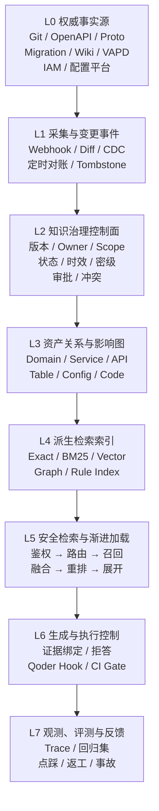

**派生索引原则**：删除索引不应导致知识丢失；索引损坏后应能从权威源重建。

**依据**：[OWASP RAG Security](https://cheatsheetseries.owasp.org/cheatsheets/RAG_Security_Cheat_Sheet.html)、[OpenAI Harness](https://openai.com/index/harness-engineering/)、[Anthropic Context Engineering](https://www.anthropic.com/engineering/effective-context-engineering-for-ai-agents)、[AWS Bedrock 同步](https://docs.aws.amazon.com/bedrock/latest/userguide/kb-data-source-sync-ingest.html)、[SLSA Provenance v1.2](https://slsa.dev/spec/v1.2/provenance)

**方向性依据**：[NIST AI RMF Core](https://airc.nist.gov/airmf-resources/airmf/5-sec-core/)。该页面是 Govern / Map / Measure / Manage 四职能的**总览页**，只说明 AI 风险管理需要治理与度量，**并未规定任何分层架构**。L0–L7 的分层、层间职责划分与「向量库仅为可重建派生索引」的定位，是本方案的**自拟结构**，其有效性由 §9 评测体系自证，不得作为验收门禁的外部依据。

**性质**：分层结构为自拟；「派生索引可重建」原则为工程推导 | **置信度**：高（原则）/ 待评测（分层）

### 6.2 元数据 Schema（决策 3）

P0 最小 frontmatter（6 字段）：

```yaml
---
status: active                         # draft | active | deprecated | revoked
source_uri: gitlab://{group}/{project}/{path}
source_revision: {commit_sha}
owner_group: ocp/{team}
classification: internal               # public | internal | confidential | restricted
title: "知识标题"
---
```

其余字段由系统自动派生：

| 派生字段                | 来源与规则                                                                                                                                     |
| ----------------------- | ---------------------------------------------------------------------------------------------------------------------------------------------- |
| knowledge_id            | 文件路径 `docs/knowledge/{module}/{topic}.md` → `KB-{MODULE}-{TOPIC}`，一经分配不再变更                                                        |
| content_hash            | **对 git blob 计算，不对工作区文件计算**：`git show {source_revision}:{path} \| sha256sum`（见 6.2.1）                                          |
| revision_id             | `{source_revision}` + `{content_hash[:12]}`，用于索引版本对齐                                                                                  |
| effective_from          | git log 中该文件的**首次**提交时间                                                                                                              |
| effective_to            | `status: active` 期间恒为 `null`；仅在转入 `deprecated` / `revoked` 时写入生效时间（见 6.2.2）                                                  |
| review_due_at           | `effective_from` 或上次复核时间 + 该知识类型的复核周期（分级，见 6.2.3）                                                                        |
| steward                 | **frontmatter 显式声明**；未声明时回落到 CODEOWNERS 派生，但派生结果必须写回 frontmatter 固化（见 §5.1）                                        |
| approvers               | CODEOWNERS 自动派生                                                                                                                            |
| flags / flagged_at      | 由 CI 写入的异常标记，人工不得手改（见 §8.4.1）                                                                                                |
| scope.\*                | P2 关系图谱从 source_uri 自动抽取                                                                                                              |

生命周期：`draft → active → deprecated → revoked`

异常标记由 CI 自动写入 `flags` 数组（**不是 status 的取值**）：`verification_overdue`（超过 `review_due_at` 仍未复核）、`drift_detected`（源文件发生语义相关变更，见 §8.4.2）、`owner_missing`（owner_group 在 GitLab 中不存在）、`conflicted`（存在未裁决的矛盾主张，见 §8.1）。

#### 6.2.1 content_hash 必须基于 git blob 而非工作区文件

对工作区文件直接计算 SHA-256 会因两类无害抖动产生**全量误报**：

- **换行符双轨**：本仓库 `.editorconfig` 对 `[*.md]` 声明 `end_of_line = crlf`，而 `.gitattributes` 声明 `* text=auto eol=lf` + `*.md text`，即工作区可能是 CRLF、仓库 blob 是 LF。同一份内容会得到两个不同的 hash。
- **格式化器**：Prettier 会重排表格对齐宽度与空行，语义未变而字节全变。

因此 hash 的输入必须统一为**规范化后的仓库字节**：

```shell
# 入库时记录
git show {source_revision}:{path} | sha256sum
# 漂移检测时比对（同一条命令，天然免疫 CRLF 与编辑器差异）
```

若确实需要对工作区文件计算，必须先做规范化（统一 LF、剥离行尾空白、按 `.gitattributes` 规则应用 filter），并把规范化算法版本写入 `hash_algo` 字段。

#### 6.2.2 effective_to 不能取「末次提交时间」

一条 `active` 知识**没有失效时间**。若把 `effective_to` 派生为「git log 末次提交时间」，则每条知识在被派生的那一瞬间就已落在有效区间之外；而 §8.1 版本裁决的第 4 条正是「当前时间是否处于有效区间」——**派生规则会与裁决规则互相击穿，导致全部知识被裁决为无效**。

正确规则：

| status         | effective_to              | 裁决含义                             |
| -------------- | ------------------------- | ------------------------------------ |
| `draft`        | `null`                    | 未生效，不参与裁决                   |
| `active`       | `null`                    | 开区间，持续有效                     |
| `deprecated`   | 进入 deprecated 的时间    | 已过 sunset 起点，仍可召回但需告警   |
| `revoked`      | 撤销时间                  | 硬失效，**任何情况下不得进入召回集** |

#### 6.2.3 复核周期按风险分级，不硬编码 90 天

「active 超 90 天未更新即过期」对安全/资金类知识过宽、对低风险 FAQ 过严。分级如下（初始建议值，须按 §14 校准）：

| 知识类型 / 风险                         | 复核周期          | 超期后果                                    |
| --------------------------------------- | ----------------- | ------------------------------------------- |
| 安全、合规、资金、权限（`restricted`）  | 30 天             | `verification_overdue` + 高优先级告警       |
| Contract（接口、表结构、配置）          | 60 天             | `verification_overdue` + 召回时附过时警告   |
| Procedure、Policy                       | 90 天             | `verification_overdue`                      |
| Concept、Decision、FAQ                  | 180 天            | 仅在检索命中时提示 Owner                    |
| 命中 §8.4.2 语义相关变更                | 立即（不等周期）  | `drift_detected`                            |

**依据**：[Backstage Descriptor Format](https://backstage.io/docs/features/software-catalog/descriptor-format/)、[NIST AI RMF Govern](https://airc.nist.gov/airmf-resources/playbook/govern/)、[Flyway Validate](https://documentation.red-gate.com/fd/validate-277578898.html)、[Git 属性与规范化](https://git-scm.com/docs/gitattributes)

**性质**：工程推导 | **置信度**：高
**待实测**：各级复核周期的实际取值（以「过期知识率 ≤ 目标值」与「Owner 告警可处理量」双向约束校准）。

### 6.3 目录结构

```text
docs/knowledge/
├── {module}/                    # 按业务模块组织
│   ├── {topic}.md               # 知识条目
│   └── ...
├── _index.yaml                  # 知识目录（路由地图）
└── _glossary.yaml               # 受控术语表（决策 15）
```

### 6.4 索引 Pipeline

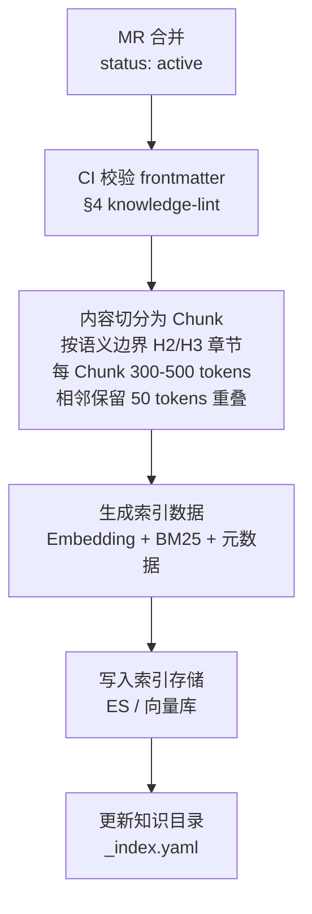

每个索引 Chunk 必须能反查到权威源：

```yaml
# frontmatter 携带（P0 最小集）
source_uri:
source_revision:
owner_group:
classification:
status:
title:

# 索引时自动附加
knowledge_id:          # 从文件路径派生
content_hash:          # CI 计算（对 git blob，见 §6.2.1）
chunk_hash:            # 内容寻址，见 §7.4.1
context_prefix:        # 上下文前缀，见 §6.6.1
index_build_id:
embedding_model_version:
acl_groups:            # 派生 chunk 继承源条目权限，见 §7.6.1
```

**切分参数是初始建议值，不是规范值**：上图中的「300-500 tokens、重叠 50 tokens」仅为起点。[Anthropic Contextual Retrieval](https://www.anthropic.com/news/contextual-retrieval) 原文只说 chunk「通常不超过几百 tokens」，**未给出具体数值**；该数值必须按本团队文档类型分别实测（见 §14），实测前应视为未定参数。

**切分与索引之间的上下文前缀步骤不可省略**：`C3 → C4` 之间必须插入「生成上下文前缀」（§6.6.1），且**前缀同时进入 Embedding 与 BM25 两个通道**。若只对向量通道加前缀，§7.1 的 BM25 通道仍检索脱离上下文的裸 chunk，混合检索的收益会被抵消一半。

**切分必须按语义边界，不得纯定长**：定长切分会切断表格与代码块，产生无法独立理解的碎片。边界优先级为 `H2 > H3 > 段落 > 句子`；单个 H2 章节超出 token 上限时才在段落边界二次切分，**表格与代码块作为不可分割单元**（超长表格按行组切分并重复表头）。

### 6.5 知识条目模板与目录 Schema（决策 26）

> §3.4 规定了知识条目「必须包含哪些要素」，但**没有给出可直接复制的文件**。开发者写第一条知识时无从下手，只能靠模仿，结果就是格式漂移——而格式漂移会直接让 §4.2 的 CI 校验失效。因此模板本身是 P0 交付物。

#### 6.5.1 知识条目模板（可直接复制）

文件路径即 `knowledge_id` 来源：`docs/knowledge/{module}/{topic}.md` → `KB-{MODULE}-{TOPIC}`。

```markdown
---
status: draft
title: "退款接口的幂等键约束"
source_uri: gitlab://ocp/payment/src/main/java/com/ocp/pay/RefundService.java
source_revision: 8f31c92a4b
owner_group: ocp/payment-team
classification: internal
---

## 背景

<!-- 为什么需要这条知识？不写会发生什么？一段话说清，不写实现细节 -->

## 方案

<!-- 技术约束的准确陈述。必须引用具体代码位置，格式见下方约定 -->

`RefundService#submit` 以 `out_trade_no + refund_seq` 组合作为幂等键，
参见 [RefundService.java:112](gitlab://ocp/payment/src/main/java/com/ocp/pay/RefundService.java#L112)。

## 正反例

### 正确做法

<!-- 代码块必须标注语言 -->

### 错误做法

<!-- 代码块 + 一句话说明为什么错、会导致什么后果 -->

## 适用范围

<!-- 涉及哪些模块 / 服务 / API / 环境；明确不适用的场景 -->
```

**代码引用约定**（三选一，按精度递减）：

| 形式 | 示例 | 适用 |
| ---- | ---- | ---- |
| 行级 | `gitlab://{group}/{project}/{path}#L112` | 单点约束，最精确 |
| 符号级 | `RefundService#submit` | 方法/字段级约束，**不随代码移动失效**，推荐默认使用 |
| 文件级 | `gitlab://{group}/{project}/{path}` | 整文件级规则 |

**优先用符号级引用**：行号在源文件任何一次编辑后都会失效，而 §8.4 的漂移检测只比对 `source_revision`，**无法发现行号已漂移**。符号级引用配合静态分析才能校验「符号是否还存在」，这一项应进入 §4.2 的 CI 检查。

#### 6.5.2 `_index.yaml` 路由地图 Schema

`_index.yaml` 是 §7.3 渐进式加载的 **L0 层**：Agent 先读它决定去哪个域找知识，再进入具体条目。**它没有 Schema，渐进式加载就无法实现**——Agent 只能全库检索，L0 层形同虚设。

```yaml
version: 1                              # Schema 版本，变更须走审批
generated_at: "2026-10-21T10:00:00Z"    # CI 生成，禁止手工编辑
domains:
  - domain: payment
    canonical_name: 支付域
    owner_group: ocp/payment-team
    classification: internal            # 该域下条目的最高密级（就高不就低）
    entry_points:                       # Agent 的入口提示
      - "退款、支付、对账、幂等"
    services: [payment-core, payment-gateway]
    knowledge_count: 42
    modules:
      - module: refund
        path: docs/knowledge/payment/refund/
        topics: [幂等, 状态机, 超时补偿]
```

**生成规则**（`_index.yaml` 必须由 CI 从 frontmatter 与目录结构反推，不允许人工维护）：

| 字段 | 来源 | 冲突处置 |
| ---- | ---- | -------- |
| `domains[].owner_group` | 该域下全部条目的 `owner_group` 众数 | 存在多个 Owner 时标记 `owner_inconsistent`，阻断索引构建 |
| `domains[].classification` | 该域下条目的**最高**密级 | 就高不就低——域级密级低于任一成员即是越权风险 |
| `knowledge_count` | 该域下 `status: active` 条目数 | 与 §6.7 索引完整性指标交叉校验 |
| `modules[].topics` | 条目 `title` 与 H2 标题聚类 | 仅提示用，不作为检索过滤条件 |

**为什么禁止手工编辑**：手工维护的目录与真实条目必然漂移，而 L0 层一旦给出错误的域归属，Agent 会**在错误的域里检索并自信地拒答**——比没有 L0 更糟，因为它把失败伪装成了「知识库中没有」。

**依据**：[Backstage Catalog `catalog-info.yaml`](https://backstage.io/docs/features/software-catalog/descriptor-format/)（声明式目录 + CI 校验的范式）、[Anthropic Context Engineering](https://www.anthropic.com/engineering/effective-context-engineering-for-ai-agents)（渐进式加载需要轻量入口层）、[DataHub Glossary](https://docs.datahub.com/docs/features/feature-guides/business-glossary/)（受控目录的 Owner 与审批）

**性质**：模板结构与 `_index.yaml` 字段集为自拟；「目录由 CI 生成、禁止手工维护」为工程推导（Backstage 范式支持） | **置信度**：中高
**待实测**：`topics` 聚类方法、域级 `entry_points` 的措辞（直接影响 L0 路由命中率）。

### 6.6 向量化与索引选型（决策 27）

> §6.4 给出了切分与索引流程，但**没有说明 chunk 如何向量化、用什么向量库、换模型怎么办**。这三项决定了检索质量的上限，也是唯一无法靠后期调参弥补的环节。

#### 6.6.1 上下文前缀切分（本方案采纳的关键技术）

[Anthropic Contextual Retrieval](https://www.anthropic.com/news/contextual-retrieval) 的核心方法：**在把 chunk 送去向量化之前，先给它拼接一段说明「这个 chunk 在整篇文档中处于什么位置、讲的是什么」的前缀**。

```text
原始 chunk：
  「该接口已废弃，请改用 v2。」

加前缀后送 Embedding：
  「本片段来自《支付域 - 退款接口契约》，
    描述 refund/v1 接口的生命周期状态。
    该接口已废弃，请改用 v2。」
```

**为什么必须做**：短 chunk 脱离上下文后语义严重不完整。「该接口已废弃」单独向量化时，向量里根本没有「哪个接口」的信息，**无论检索算法多好都召回不到**。前缀把缺失的上下文补回向量空间。

Anthropic 公布的失效下降幅度（以 top-20 检索失败率计）：

| 方法组合 | 检索失败率下降 |
| -------- | -------------- |
| 上下文 Embedding 单独使用 | −35% |
| + 上下文 BM25 | −49% |
| + Reranking | −67% |

**上下文 BM25 同样要做**：前缀不仅进向量，也要进 BM25 索引。本方案的 §7.1 已有 BM25 通道，但**未说明该通道索引的是前缀增强后的文本**——这是原文与本方案此前的脱节点，此处补齐。

**成本提示**：前缀由 LLM 生成，意味着**每次索引构建都要调用 LLM**。Anthropic 用 Prompt Caching 降低成本；本方案应缓存「文档级上下文」（整篇文档的摘要可复用），只对 chunk 级前缀做增量生成。此项成本必须计入 §12 的成本模型。

**待实测**：前缀长度、前缀生成 Prompt、是否对全部知识类型启用（FAQ 类短条目可能收益有限）。

#### 6.6.2 Embedding 模型选型要点

| 考量 | 要求 | 说明 |
| ---- | ---- | ---- |
| 中英混合 | 必须 | 企业知识普遍中英混杂，纯英文模型在中文上退化明显 |
| 代码语义 | 建议 | 知识条目含代码引用与代码块，需能理解标识符 |
| 最大输入长度 | ≥ chunk 上限 + 前缀长度 | **前缀会挤占有效长度**，选型时必须按「chunk + 前缀」总和校验 |
| 维度 | 与向量库成本权衡 | 维度越高召回越好但存储与计算成本线性上升 |
| 版本可锁定 | 必须 | 模型升级会改变向量空间，见 §6.6.4 |

**不得直接使用未评估的模型**：Embedding 模型的选择直接决定 Recall@K 上限，必须用 §9.2 的评测集（尤其是「精确标识符集」）实测后再定，不接受榜单排名作为选型依据——公开榜单的语料分布与企业内部技术文档差异极大。

#### 6.6.3 向量存储与索引类型

| 方案 | 适用场景 | 主要代价 |
| ---- | -------- | -------- |
| Elasticsearch / OpenSearch | 已有 ES 集群，需要 BM25 与向量**同库** | 向量检索性能弱于专用库 |
| Milvus | 大规模（千万级向量）、需要独立扩缩容 | 多一套存储运维 |
| Qdrant | 中等规模、重视过滤性能（本方案的密级过滤是硬需求） | 生态较新 |
| pgvector | 已有 PostgreSQL、向量量级不大、希望事务一致 | 大规模下性能受限 |

**选型的决定性因素是过滤性能，不是纯向量吞吐**：§7.6 要求在检索前按 `classification` 与权限过滤，这是**每次查询都带的高选择性过滤条件**。若向量库采用「先 ANN 召回再过滤」（post-filtering），过滤掉的比例越高，Top-K 越容易不足，**Recall@K 会被权限过滤系统性拉低**。必须选用支持 filtered ANN（pre-filtering 或 filter-aware HNSW）的方案，并把「带过滤的 Recall@K」单列为评测项。

索引类型：

| 索引 | 特点 | 适用 |
| ---- | ---- | ---- |
| HNSW | 查询快、召回高，内存占用大，增量插入友好 | 默认选择 |
| IVF | 内存低，需训练，召回受 `nprobe` 影响 | 超大规模且内存受限 |

**依据**：[Anthropic Contextual Retrieval](https://www.anthropic.com/news/contextual-retrieval)（上下文前缀方法与 −35%/−49%/−67% 数据）、[Azure AI Search 混合检索](https://learn.microsoft.com/en-us/azure/search/hybrid-search-overview)、[Elastic Hybrid Search](https://www.elastic.co/elasticsearch/hybrid-search)、[pgvector](https://github.com/pgvector/pgvector)、[Milvus](https://milvus.io/docs)、[Qdrant](https://qdrant.tech/documentation/)

**性质**：上下文前缀与其效果数据为**直接依据**（Anthropic 原文公布）；存储与索引选型为工程推导，具体产品取舍须按本团队规模与运维能力确定 | **置信度**：高（方法）/ 待实测（选型）
**待实测**：Embedding 模型与维度、chunk 大小与前缀长度组合、HNSW 参数（`M`、`efConstruction`、`efSearch`）、带过滤的 Recall@K。

#### 6.6.4 模型版本迁移：双索引蓝绿切换

Embedding 模型一旦升级，**全部向量都失效**——新旧模型的向量不在同一空间，混合检索会产生无意义的相似度。因此必须支持双索引并存：

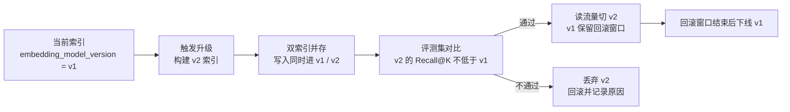

关键约束：

- 索引中每个 chunk 必须携带 `embedding_model_version`（§6.4 已列该字段），**这是双索引能并存的前提**。
- 升级期间写入必须**同时进两个索引**，否则切换后会漏掉窗口期新增的知识。
- 切换判据是 §9.2 评测集的 Recall@K 与 Precision@K，**不是「新模型榜单分更高」**。
- 回滚窗口内 v1 索引不得删除；窗口长度须实测确定。

**成本约束**：双索引期间存储与写入成本翻倍。因此模型升级必须是**计划性事件**（如季度评审），不能因为「出了个新模型」就随时切换。

**性质**：工程推导 | **置信度**：高
**待实测**：回滚窗口长度、双索引期间的写入放大是否触发容量瓶颈。

### 6.7 度量

| 指标 | 计算方式 | 目标 | 性质（§1.3） |
| ---- | -------- | ---- | ------------ |
| 索引延迟 | MR 合并到 Chunk 可检索的时间 | ≤ 5 分钟 | 阈值待实测 |
| 索引完整性 | 索引 Chunk 对应的条目数 / docs/knowledge/ 下 active 条目数 | 100% | 机制保证（对账任务可直接判定，缺口即失败） |
| 索引重建时间 | 从权威源完整重建全部索引的时间 | ≤ 30 分钟 | 阈值待实测（随语料规模变化，须按实际条数校准） |
| 前缀覆盖率 | 已生成上下文前缀的 chunk 数 / 总 chunk 数 | 100% | 机制保证（索引 Pipeline 内强制步骤，缺失即构建失败） |
| 模型版本一致率 | 索引中 `embedding_model_version` 唯一的比例 | 100%（非迁移期） | 机制保证（迁移期允许双版本，须显式标记迁移中） |

---

## 7. 知识检索与引用

> 本阶段解决：Agent 如何找到并使用知识？如何保证输出可信？

### 7.1 混合检索架构（决策 14）

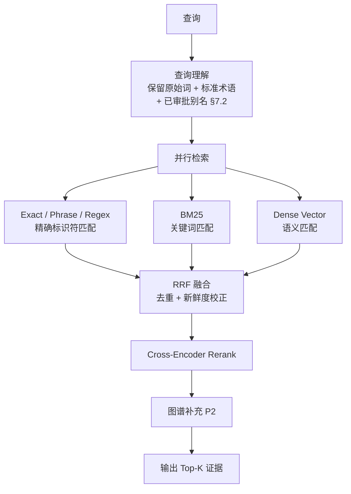

#### 7.1.1 RRF 融合的具体公式与参数

```text
RRF(d) = Σ_{r ∈ 检索通道} 1 / (k + rank_r(d))
```

- `rank_r(d)`：文档 d 在通道 r 结果列表中的**名次**（从 1 开始），不是相似度分数。用名次而非分数，正是为了免去 BM25 分数与余弦相似度不可比的问题——这是 RRF 的核心价值，也是不能替换为「加权求和」的原因。
- `k`：平滑常数。**起始值取 60**（Azure AI Search 官方建议 k 取小值如 60；Elasticsearch `rrf` retriever 的 `rank_constant` 默认 60）。k 越小，头部名次的权重差异越大；k 越大，各通道结果越趋于平均。
- 每通道先取 `rank_window_size` 条（Elasticsearch 默认 100）参与融合，再截断。
- 只进入一个通道的文档仍可参与融合，不因「未被多通道确认」而丢弃——精确标识符命中往往只有 Exact 通道有结果。

**去重键**：`chunk_hash`。同一 chunk 被多通道召回时合并分数，不重复占用 Top-K 名额。

**新鲜度校正**：融合分数乘以时效因子后再重排。校正必须**只作用于同一条知识的不同修订**，不得跨知识比较时间——否则新写的低质量知识会系统性压过稳定的高质量知识。`deprecated` / `revoked` 的修订不参与召回（见 §6.2.2）。

#### 7.1.2 Cross-Encoder Rerank 的适用范围

Rerank 是链路中延迟最高的一环，**必须限定候选数量**：

| 部署方式 | 候选数量级 | 说明 |
| -------- | ---------- | ---- |
| 本地 GPU | Top 20–50 | 延迟可控，推荐 |
| 本地 CPU（ONNX 量化） | Top 20 | 延迟随候选数近似线性增长 |
| 云 Rerank API | Top 20 | 需叠加网络往返，且构成外部依赖，须配熔断 |

超过该量级时 rerank 会成为 P95 的主要贡献者。因此**先用融合分数截断到候选窗口，再 rerank**，不能对全量召回结果 rerank。

#### 7.1.3 延迟预算分解

`检索延迟 P95 ≤ 500ms`（§7.8）必须能被分解，否则不可验证也不可归因：

| 环节 | 预算 | 超预算时的处置 |
| ---- | ---- | -------------- |
| 查询理解（术语/别名扩展） | 由 §7.2 的**查表**实现，不调用 LLM | 若引入 LLM 改写，500ms 目标不再成立，须另立预算 |
| 三路并行召回 | 取三路最大值，非求和 | 单通道超时则降级为双通道，记录 `retrieval_degraded` |
| RRF 融合 | 内存计算，量级可忽略 | — |
| Cross-Encoder Rerank | 候选窗口按 §7.1.2 限定 | 超时则跳过 rerank，直接用融合分数，记录降级 |
| 图谱补充（P2） | 可异步、可缺失 | 缺失不阻断主链路 |

**关键约束**：上表中「查询理解不调用 LLM」是 500ms 目标成立的**前提条件**，不是优化建议。若业务要求 LLM 查询改写，必须把目标改为分层预算（如改写 800ms + 检索 500ms）并在 §7.8 中单列。

**依据**：[Azure AI Search：混合检索排序与 RRF](https://learn.microsoft.com/en-us/azure/search/hybrid-search-ranking)（k 取小值如 60）、[Elasticsearch RRF retriever](https://www.elastic.co/docs/reference/elasticsearch/rest-apis/reciprocal-rank-fusion)（`rank_constant` 默认 60、`rank_window_size` 默认 100）、[Cormack et al. 2009：Reciprocal Rank Fusion outperforms Condorcet and individual Rank Learning Methods](https://dl.acm.org/doi/10.1145/1571941.1572114)（RRF 公式原始来源）、[Azure Hybrid Search](https://learn.microsoft.com/en-us/azure/search/hybrid-search-overview)、[Elastic Hybrid Search](https://www.elastic.co/elasticsearch/hybrid-search)、[Microsoft Research GraphRAG](https://www.microsoft.com/en-us/research/publication/from-local-to-global-a-graph-rag-approach-to-query-focused-summarization/)

**术语归属说明**：[Anthropic Contextual Retrieval](https://www.anthropic.com/news/contextual-retrieval) 原文用词是 "rank fusion techniques" 与 "the Cohere reranker"，**并未点名 RRF 或 Cross-Encoder**。本节选用 RRF 与 Cross-Encoder 是工程选型，其权威来源是上表前三项。Anthropic 该文真正独有、且本方案采纳的技术是**上下文前缀切分**，见 §6.6.1。

**性质**：RRF 公式与 k 默认值为直接依据；延迟预算分解为自拟（须实测校准） | **置信度**：高（公式）/ 待实测（预算分配）
**待实测**：Top-N、Top-K、k 值、rank_window_size、rerank 候选窗口、各环节预算占比。

### 7.2 受控术语表（决策 15）

```yaml
term: OCP
canonical_name: 内容开放平台
aliases: [开放平台, 萌视, fc-open]
historical_names: [PGC开放平台]
entity_type: domain
owner_group: ocp/backend
```

查询同时保留原始词、标准术语、已审批别名和历史名称，不允许模型自由猜测内部缩写。

**依据**：[DataHub Glossary](https://docs.datahub.com/docs/features/feature-guides/business-glossary/)、[NIST AI 100-3](https://doi.org/10.6028/NIST.AI.100-3)、[Anthropic Context Engineering](https://www.anthropic.com/engineering/effective-context-engineering-for-ai-agents)

**性质**：工程推导 | **置信度**：高

### 7.3 渐进式上下文加载（决策 16）

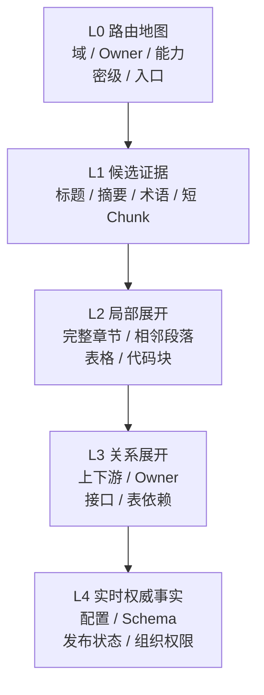

**依据**：[Anthropic Context Engineering](https://www.anthropic.com/engineering/effective-context-engineering-for-ai-agents)、[OpenAI Harness](https://openai.com/index/harness-engineering/)

**性质**：直接依据 + 工程推导 | **置信度**：中高
**说明**：该设计来自官方工程实践，具体预算需在本团队环境验证。

### 7.4 引用系统（决策 17）

引用由系统生成，模型只能使用检索到的证据 ID：

```yaml
evidence:
  evidence_id: ev-{trace_id}-{n}                   # 单次检索内的短生命周期句柄，模型只允许引用它
  chunk_ref:                                       # 长期稳定标识，写入审计日志与回归集
    knowledge_id: "KB-PAYMENT-001"
    knowledge_revision: "8f31c92"                  # = source_revision
    section_anchor: "实现方案"                      # H2/H3 标题文本，不随切分参数变化
    chunk_hash: "sha256:9c1f..."                   # 内容寻址：切分参数变了它才变
  source_uri: "gitlab://ocp/payment/src/.../RefundService.java"
  line_range: "45-78"
  classification: "confidential"
  retrieved_at: "2026-10-21T10:30:00Z"
  rerank_score: 0.87
```

模型输出格式：

```json
{
  "claim": "接口已经废弃",
  "evidenceIds": ["ev-a1b2c3-003"]
}
```

#### 7.4.1 为什么 evidence_id 不能用 chunk 序号

若采用 `ev-{knowledge_id}-{chunk_seq}` 这类**位置寻址**的 ID，`chunk_seq` 完全由切分结果决定：知识条目增删一个 H2、或切分参数从 300-500 tokens 调整为其他值，**全部 chunk 序号整体位移**。后果是链式的：

- §9.2 评测集的 `expected_citations` 全部失效，回归结果不可比；
- §9.3 反馈闭环中已归因的历史引用指向错误 chunk；
- §7.8「幻觉引用率 = 0」与 §8.8「删除残留率 = 0」都要求引用长期可追溯，位置寻址做不到。

因此拆成两层标识：

| 标识            | 生命周期   | 生成方式                                       | 用途                                   |
| --------------- | ---------- | ---------------------------------------------- | -------------------------------------- |
| `evidence_id`   | 单次检索   | `ev-{trace_id}-{序号}`，随 trace 结束失效       | 模型输出的引用句柄，用于校验模型是否越界引用 |
| `chunk_ref`     | 长期       | `knowledge_id` + `section_anchor` + `chunk_hash` | 审计日志、回归集、反馈归因的持久引用   |

校验规则：模型输出的每个 `evidence_id` 必须存在于本次检索返回的集合中，否则该 claim 整体丢弃并计入「幻觉引用」——**该指标因此是机制保证而非模型自觉**（见 §7.8）。

#### 7.4.2 知识修订后的引用可解析性

`chunk_ref` 携带 `knowledge_revision`，因此即使知识已被修订或废弃，历史引用仍能定位到当时的版本（Git 中该 commit 永久可达）。当 `section_anchor` 在新版本中不存在时，按以下顺序降级解析：`chunk_hash` 精确匹配 → `section_anchor` 模糊匹配 → 回落到 `knowledge_id` 整条并标注「引用定位已降级」。降级事件计入 §7.8 的引用可解析率。

**依据**：[OWASP RAG Security: Source Attribution](https://cheatsheetseries.owasp.org/cheatsheets/RAG_Security_Cheat_Sheet.html#section-5-source-attribution-and-provenance)、[Google Check Grounding](https://docs.cloud.google.com/generative-ai-app-builder/docs/check-grounding)、[SLSA Provenance v1.2](https://slsa.dev/spec/v1.2/provenance)

**性质**：工程推导 | **置信度**：高
**待实测**：`section_anchor` 模糊匹配的相似度阈值、引用可解析率的目标值。

### 7.5 拒答与降级（决策 18）

以下情况禁止作为确定性答案输出：

- 没有可靠证据 → 拒答：「知识库中未找到相关信息」
- 只有过期版本 → 拒答：「相关信息已过期，请联系 Owner 确认」
- 来源互相冲突 → 降级：「存在多个版本的说法，以下是各方观点...」
- 权限判断失败 → 拒答：「您没有权限查看相关信息」
- 来源完整性验证失败 → 拒答
- 引用与当前版本不一致 → 警告：「以下信息可能已过时」

**依据**：[OWASP RAG Security: Fail-Closed](https://cheatsheetseries.owasp.org/cheatsheets/RAG_Security_Cheat_Sheet.html#section-14-fail-closed-design)、[Microsoft RAG Evaluators](https://learn.microsoft.com/en-us/azure/ai-foundry/concepts/evaluation-evaluators/rag-evaluators)、[RAGAS](https://arxiv.org/abs/2309.15217)

**性质**：直接依据 + 工程推导 | **置信度**：高

### 7.6 权限、安全与全链路审计（决策 12、13）

> 本节补齐两个此前**只在附录出现、正文无落地设计**的决策。同时纠正一处优先级错误：附录原将「Chunk 级 ACL + 检索前权限过滤」排在 P3，理由是「知识库内部使用，规模化后再收紧权限」。这个理由不成立——**密级字段 `classification` 已在 P0 的 6 字段 frontmatter 中采集，§7.5 也已承诺「权限判断失败 → 拒答」**；采集了密级却不据此过滤，等于对外声明了一个不存在的控制，比不做更危险。因此检索前密级过滤**提升到 P0**。

#### 7.6.1 权限模型：检索前过滤 + Chunk 级 ACL

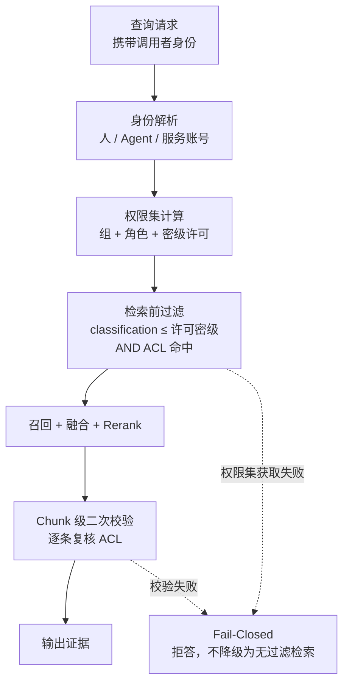

三条硬性要求：

1. **过滤发生在检索之前，不是之后**。post-filtering 会让 Top-K 数量不可控（见 §6.6.3），并且被过滤掉的文档仍参与了 ANN 计算，在高选择性过滤下召回严重不足。
2. **身份必须传播到检索层**。Agent 代替人调用时，**使用发起人的权限，不使用 Agent 自身的服务账号权限**。否则任何 Agent 都成为越权通道——这是 OWASP 所列 Access Control Inheritance 威胁的核心。
3. **权限集获取失败 = 拒答**。不得回落为「无过滤检索」，也不得回落为「只查 public」。回落逻辑本身就是越权路径。

Chunk 级 ACL 的存储方式：ACL 作为 chunk 元数据的**过滤字段**写入索引（而非仅在应用层判断），使过滤能下推到存储引擎：

```yaml
# 索引中每个 chunk 的权限字段
classification: confidential          # public | internal | confidential | restricted
acl_groups: [ocp/payment-team, ocp/security]   # 命中任一即可读
acl_deny: []                          # 显式拒绝，优先级高于 allow
inherits_from: KB-PAYMENT-001         # 派生 chunk 必须继承源条目权限，不得放宽
```

**`inherits_from` 是关键约束**：切分产生的 chunk 必须继承源条目的权限，**且不允许任何环节放宽**。摘要、前缀（§6.6.1）、图谱节点、缓存条目都是派生产物，全部适用同一条继承规则。派生产物权限放宽是隐蔽的越权路径——原文受控，摘要却是 public。

#### 7.6.2 OWASP RAG Security 14 类威胁 → 本方案控制项映射

此前正文引用 OWASP 4 次，但只覆盖其中 5 类威胁。完整映射如下，**未覆盖项即为待建设项，不得视为已解决**：

| # | OWASP 威胁 | 本方案控制项 | 状态 |
| - | ---------- | ------------ | ---- |
| 1 | Document Poisoning（文档投毒） | §3.5.3 解析 fail-closed；§4.2 源文件存在性校验；§5.2 人工审批 | 部分覆盖（缺投毒内容的事后召回机制） |
| 2 | Embedding Manipulation（向量操纵） | §6.6.4 模型版本锁定 + 双索引；`embedding_model_version` 入库 | 部分覆盖（缺向量空间的异常检测） |
| 3 | Context Window Attacks（上下文窗口攻击） | §7.3 渐进式加载限定单次注入量；Top-K 硬上限 | 部分覆盖（缺超长 chunk 的截断策略） |
| 4 | Access Control Inheritance（权限继承） | §7.6.1 身份传播 + `inherits_from` 强制继承 | **本节新增，已覆盖** |
| 5 | Source Attribution and Provenance（来源归属） | §7.4 引用系统 + `chunk_ref` 长期标识 | 已覆盖 |
| 6 | Chunk Isolation（chunk 隔离） | §7.4.1 双层标识；§6.4 按语义边界切分 | 部分覆盖（缺 chunk 间越界引用的检测） |
| 7 | Index Integrity（索引完整性） | §6.7 索引完整性 = 100%（机制保证）；§6.1 派生索引可重建 | 已覆盖 |
| 8 | Query Injection via Retrieval（检索侧查询注入） | §7.2 受控术语表禁止模型自由猜测缩写；查询理解不调用 LLM（§7.1.3） | 部分覆盖（缺查询侧的注入检测） |
| 9 | Output Validation and Enforcement（输出校验） | §7.4.1 `evidence_id` 白名单校验，命中即丢弃整条 claim | 已覆盖 |
| 10 | Tool Invocation and Agent Safety（工具调用与 Agent 安全） | §10.1 Qoder Hook 阻断；§10.1.4 Worktree 隔离 | 部分覆盖（缺知识库→工具调用的授权链） |
| 11 | Caching Risks（缓存风险） | **未覆盖** | 待建设：缓存键必须包含身份与权限集，否则跨用户串味 |
| 12 | Monitoring and Incident Response（监控与响应） | §7.6.3 审计日志；§9.3 反馈闭环 | 部分覆盖（缺安全事件的响应流程） |
| 13 | Supply Chain Risk in Ingestion（摄入侧供应链） | §3.5 外部来源解析边界；`source_uri` 可追溯 | 部分覆盖（缺第三方解析器的来源审查） |
| 14 | Fail-Closed Design（失败即关闭） | §7.5 拒答与降级；§7.6.1 权限获取失败即拒答；§3.5.3 解析失败不入库 | 已覆盖 |

**第 11 项（缓存）是当前唯一的完全空白**，且风险具体：检索结果若按「查询文本」做缓存键，A 用户（`restricted` 许可）的结果会被 B 用户（`internal` 许可）命中，**直接泄露高密级内容**。缓存键必须为 `hash(查询文本 + 调用者权限集 + 索引版本)`，且高密级结果**默认不缓存**。

#### 7.6.3 全链路审计（决策 13）

审计日志是事后追溯的唯一手段，也是 §9 评测与反馈闭环的数据来源。

| 字段 | 说明 |
| ---- | ---- |
| `trace_id` | 全链路唯一 ID，串联查询→检索→生成→引用→工具调用 |
| `actor` | 发起人身份（**人，不是 Agent 服务账号**）+ Agent 标识 |
| `query_text` | 原始查询与查询理解后的扩展查询，两者都记 |
| `permission_set` | 本次生效的权限集摘要（hash，不记明文，避免日志本身成为敏感数据） |
| `retrieved_chunks` | 召回的 `chunk_ref` 列表 + 各路分数 + 是否被权限过滤掉 |
| `filtered_out_count` | 因权限被过滤的条数——**这是越权尝试的主要信号** |
| `generated_claims` | 模型输出的 claim 与 `evidenceIds` |
| `rejected_claims` | 被 §7.4.1 校验丢弃的 claim 及丢弃原因 |
| `refusal` | 是否拒答 + 拒答原因分类（§7.5 的六类） |
| `latency_breakdown` | §7.1.3 各环节耗时 |
| `index_version` | `index_build_id` + `embedding_model_version` |

四条纪律：

1. **审计日志不可篡改**：仅追加写入（append-only），与业务库分离存储。若日志可被修改，「事后追溯」不成立。
2. **被过滤的记录也要记**：只记成功召回，就无法发现越权尝试。`filtered_out_count` 持续异常应触发告警。
3. **日志本身有密级**：`query_text` 可能包含敏感业务信息，日志的访问权限须独立管控，不得默认对全体开发可见。
4. **保留期须合规确定**：保留多久由合规要求决定，不由技术便利决定。保留期内必须可按 `trace_id` 完整还原一次交互。

**依据**：[OWASP RAG Security Cheat Sheet](https://cheatsheetseries.owasp.org/cheatsheets/RAG_Security_Cheat_Sheet.html)（14 类威胁；Access Control Inheritance、Caching Risks、Monitoring and Incident Response、Fail-Closed Design 为本节直接依据）、[OpenTelemetry GenAI 语义约定](https://opentelemetry.io/docs/specs/semconv/gen-ai/)（trace 字段口径）、[SLSA Provenance v1.2](https://slsa.dev/spec/v1.2/provenance)（过程可追溯）

**性质**：OWASP 14 类映射为直接依据；审计字段清单与四条纪律为工程推导；权限模型的具体字段设计为自拟 | **置信度**：高（威胁映射、fail-closed）/ 中高（字段清单）
**待实测**：权限过滤对 Recall@K 的实际影响、缓存命中率与串味风险权衡、审计日志保留期（须合规确认，**不可由技术侧自拟**）。

### 7.7 Agent 集成接口与知识分流（决策 28）

> 前面所有章节都在讲知识如何被组织与检索，但**没有回答「Agent 通过什么接口拿到知识」**。接口形态决定了前述全部控制能否真正生效——若 Agent 直接读文件，则权限过滤、引用校验、审计日志全部被绕过。

#### 7.7.1 三种集成形态对比

| 形态 | 权限过滤 | 引用校验 | 审计 | 适用 |
| ---- | -------- | -------- | ---- | ---- |
| **MCP Server**（推荐） | 服务端强制 | 服务端强制 | 完整 | Agent 生态标准接口，多 Agent 复用 |
| HTTP API | 服务端强制 | 服务端强制 | 完整 | 非 MCP 客户端、跨语言调用 |
| 直接读文件 + grep | **无法强制** | 无 | 无 | 仅限 `public` 且无密级的少量知识 |

**结论：直接读文件不能作为知识库的主接口**。它绕过了 §7.6 的全部控制。若团队现状是 Agent 直接 grep 仓库，那么 `classification` 字段事实上不生效——这一点必须如实写入现状评估，不能声称已有权限管控。

#### 7.7.2 MCP Server 接口形态

```yaml
tools:
  - name: search_knowledge
    description: 按查询检索知识，返回带证据 ID 的 Top-K 片段
    inputSchema:
      query: string            # 必填
      domain: string           # 可选，来自 _index.yaml 的域列表
      top_k: integer           # 可选，服务端有硬上限
      min_classification: string  # 服务端会用调用者实际许可取交集，不接受越权请求
    # 返回：evidence 列表（含 evidence_id 与 chunk_ref，见 §7.4）+ 拒答原因

  - name: get_evidence
    description: 按 evidence_id 取回完整片段（§7.3 的 L2 局部展开）
    inputSchema:
      evidence_id: string

  - name: expand_relations
    description: 取回上下游依赖、Owner、接口与表关系（§7.3 的 L3）
    inputSchema:
      knowledge_id: string

  - name: list_glossary
    description: 查询受控术语表（§7.2），供 Agent 校正内部缩写
    inputSchema:
      term: string

resources:
  - uri: knowledge://index
    description: _index.yaml 路由地图（§6.5.2），供 L0 层加载

prompts:
  - name: grounded_answer
    description: 强制引用与拒答规则的系统提示（§7.4、§7.5）
```

四条设计约束：

1. **`top_k` 服务端必须有硬上限**。客户端可请求大 K，但服务端按 §7.1.3 的延迟预算截断，否则单次调用可撑爆上下文窗口（OWASP 威胁 #3）。
2. **`min_classification` 只能收紧不能放宽**。服务端取「请求值 ∩ 调用者实际许可」，请求越权值时**静默按实际许可执行并记录**，不报错——报错会泄露「存在更高密级内容」这一事实。
3. **渐进式加载通过工具分层实现**：`search_knowledge`（L1 候选）→ `get_evidence`（L2 展开）→ `expand_relations`（L3 关系）→ 实时权威事实（L4，走各平台 API，不经知识库）。**不提供「一次返回全文」的工具**，否则 §7.3 的预算控制失效。
4. **变更推送**：若客户端支持 `resources/subscribe`，知识废弃（§8.6）与漂移标记（§8.4）应主动推送，使 Agent 不必等到下次检索才发现知识已失效。不支持时降级为 `search_knowledge` 返回值中携带 `stale_warning` 字段。

#### 7.7.3 知识分流判据：AGENTS.md / 知识库 / 机器规则

同一条约束放在哪里，效果完全不同。**分流错误是本方案最容易失效的地方**：把该编译成规则的约束写成知识条目，Agent 可能检索不到；把该按需检索的细节塞进 AGENTS.md，会常驻消耗上下文预算。

| 判据 | 归属 | 理由 |
| ---- | ---- | ---- |
| 每次交互都必须遵守、且违反后果严重 | **AGENTS.md / 常驻上下文** | 检索有失败概率，常驻才能保证 100% 生效 |
| 可被机器确定性判定（有明确模式） | **编译为规则**（Lint / Semgrep / CI / Hook） | 见 §10.1.2，机械规则不依赖模型自觉 |
| 需要解释「为什么」、含权衡与背景 | **知识库条目** | 规则无法承载理由；按需检索避免常驻占用 |
| 只在特定模块 / 特定任务才相关 | **知识库条目** | 常驻会造成无关上下文污染 |
| 实时状态（配置生效值、发布状态、权限） | **不入知识库**，走权威平台 API | 见 §3.1，实时事实入库必然过期 |

**冲突时的优先级**：机器规则 > AGENTS.md > 知识库检索结果。理由是可强制性依次递减——规则一定执行，常驻提示大概率被遵守，检索结果可能被忽略。**当知识库条目与机器规则矛盾时，视为知识已过时，立即标记 `drift_detected`**（§8.4），而不是让 Agent 自行判断该听谁的。

**依据**：[Model Context Protocol 规范](https://modelcontextprotocol.io/specification)（tools / resources / prompts / subscribe 的接口形态）、[OpenAI Harness Engineering](https://openai.com/index/harness-engineering/)（机械规则优先于口头约定）、[Anthropic Context Engineering](https://www.anthropic.com/engineering/effective-context-engineering-for-ai-agents)（上下文预算与按需加载）、[OWASP RAG Security](https://cheatsheetseries.owasp.org/cheatsheets/RAG_Security_Cheat_Sheet.html)（Tool Invocation and Agent Safety、Context Window Attacks）

**性质**：MCP 接口形态有直接依据（协议规范）；分流判据与优先级为工程推导 | **置信度**：中高
**待实测**：`top_k` 硬上限、常驻上下文的预算占比、AGENTS.md 与知识库的内容边界（须按团队实际违规类型迭代）。

### 7.8 度量

| 指标 | 计算方式 | 目标 | 性质（§1.3） |
| ---- | -------- | ---- | ------------ |
| Recall@K | 正确证据进入 Top-K 的比例 | ≥ 90% | 阈值待实测 |
| Precision@K | Top-K 中正确证据的比例 | ≥ 70% | 阈值待实测 |
| Faithfulness | 模型引用是否真实支持对应主张 | ≥ 95% | 阈值待实测（依赖 LLM-as-Judge，须先校准判官一致性，见 §9.5） |
| 幻觉引用率 | 模型输出的 evidence_id 不在本次检索结果集中的比例 | = 0 | **机制保证**（evidence_id 由系统生成并在输出校验层拦截，不依赖模型自觉，见 §7.4.1） |
| 拒答准确率 | 无可靠证据时正确拒答的比例 | ≥ 95% | 阈值待实测 |
| 引用可解析率 | `chunk_ref` 能解析回当前知识版本的比例 | ≥ 95% | 阈值待实测（降级路径见 §7.4.2） |
| 检索延迟 P95 | 从查询到返回 Top-K 的时间 | ≤ 500ms | 阈值待实测（**前提是查询理解不调用 LLM**，预算分解见 §7.1.3） |
| 越权拦截率 | 权限过滤拦截的越权请求 / 全部越权请求 | = 100% | **机制保证**（§7.6.1 检索前过滤 + Fail-Closed，非过滤即失败） |
| 权限过滤后 Recall@K | 带权限过滤的检索中正确证据进入 Top-K 的比例 | 不低于无过滤值的可接受折扣 | 阈值待实测（折扣幅度须实测，见 §6.6.3） |
| 审计完整率 | 有完整 `trace_id` 链路的交互数 / 总交互数 | 100% | **机制保证**（缺 trace 的交互应被拒绝服务，而非仅记录缺失） |
| 缓存串味事件数 | 缓存返回了超出调用者密级的结果的次数 | = 0 | **机制保证**（缓存键含权限集，见 §7.6.2 第 11 项） |

---

## 8. 知识维护与治理

> 本阶段解决：知识入库后如何保持新鲜、一致、无冗余？

### 8.1 版本裁决规则（决策 4）

有效版本不能仅按修改时间判断，裁决顺序：

1. 适用系统、服务、环境和版本是否匹配。
2. 是否经过正式审批。
3. 是否已经发布或生效。
4. 当前时间是否处于有效区间。
5. 是否被 `supersedes` 指向的新版本替代。
6. 权威源等级是否更高（等级表见下）。
7. 无法裁决时标记 `conflicted`，不允许模型自行选择。

**权威源等级表**（第 6 条若无等级定义则不可执行）：

| 等级 | 权威源类型 | 示例 |
| ---- | ---------- | ---- |
| T1 | 机器可校验的契约与 Schema | OpenAPI / Proto / IDL / Migration |
| T2 | 运行时事实 | 发布平台状态、配置中心实际生效值、IAM 实际授权 |
| T3 | 已审批的知识条目与 ADR | `status: active` 的 `docs/knowledge/**`、已合并 ADR |
| T4 | 设计文档与评审结论 | Wiki、Confluence、设计评审纪要 |
| T5 | 沟通记录 | IM、会议纪要、MR 评论 |

同一主张在 T1/T2 与 T3–T5 冲突时，**以 T1/T2 为准并立即对低等级条目标记 `drift_detected`**；同级冲突才进入 `conflicted` 流程。T5 不得单独作为确定性答案来源（与 §7.5 拒答规则一致）。

**依据**：[OpenAPI](https://spec.openapis.org/oas/v3.1.2)（规范文件自带版本与适用环境声明，支撑第 1 条）、[Backstage Descriptor Format](https://backstage.io/docs/features/software-catalog/descriptor-format/)（`spec.lifecycle` 支撑第 2、3 条）

**方向性依据**：[NIST AI RMF Core](https://airc.nist.gov/airmf-resources/airmf/5-sec-core/)。该页为四职能总览，未规定裁决顺序；七条顺序与五级权威源分级是本方案的**自拟设计**。

**性质**：裁决顺序与等级表为自拟，第 1–3 条有直接依据 | **置信度**：高

### 8.2 事件同步与对账（决策 8）

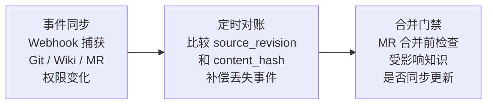

**依据**：[AWS Bedrock 同步](https://docs.aws.amazon.com/bedrock/latest/userguide/kb-data-source-sync-ingest.html)、[Azure AI Search Changed Blobs](https://learn.microsoft.com/en-us/azure/search/search-howto-index-azure-blob-changed-deleted)、[GitLab Auto Merge](https://docs.gitlab.com/user/project/merge_requests/auto_merge/)、[GitLab Code Owners](https://docs.gitlab.com/user/project/codeowners/)

**性质**：工程推导 | **置信度**：高

### 8.3 契约变更触发知识检查（决策 9）

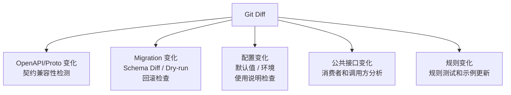

**依据**：[OpenAPI](https://spec.openapis.org/oas/v3.1.2)、[Flyway Validate](https://documentation.red-gate.com/fd/validate-277578898.html)、[Liquibase Checksums](https://docs.liquibase.com/concepts/changelogs/changeset-checksums.html)、[GitLab Code Owners](https://docs.gitlab.com/user/project/codeowners/)

**性质**：工程推导 | **置信度**：高

### 8.4 漂移检测实施

#### 8.4.1 标记写入独立字段，不污染 status

`status` 的枚举值固定为 `draft | active | deprecated | revoked`（见 §6.2），漂移与过期是**叠加在 status 之上的独立标记**，写入 `flags` 数组。一条知识可以同时是 `status: active` 且 `flags: [drift_detected, verification_overdue]`——「仍然生效但已待复核」正是治理最需要表达的复合状态；若把 `verification_overdue` 写进 `status`，既产生非法枚举值（会被 §4.2 的枚举校验拦下），又丢失了这个复合状态。

```yaml
# frontmatter 增量字段（由 CI 写入，人工不得手改）
flags: []          # 取值：drift_detected | verification_overdue | owner_missing | conflicted
flagged_at:        # ISO 8601，最近一次打标时间
```

#### 8.4.2 检测逻辑：语义相关性过滤 + 批量取 commit

源文件的**任意一次提交**（格式化、注释改动、无关重构、rename）都判定漂移，会产生 Owner 无法处理的告警量，最终导致告警被集体忽略——这是治理系统最典型的失效方式。因此漂移判定分两级：

```text
# scripts/drift-check.py（伪代码）
# 一次性建立 路径 → 最新 commit 的反向映射，避免逐条调 git（上千条目后是性能瓶颈）
commit_map = parse( git log --name-only --pretty=format:%H -- {watched_paths} )

for entry in knowledge_entries(status == active):
    latest = commit_map[resolve(entry.source_uri)]
    if latest == entry.source_revision:
        continue                                    # 未漂移

    # 一级：源文件确有变更 → 记录候选，不立即告警
    changed_hunks = git diff entry.source_revision..latest -- {path}

    # 二级：只有命中语义相关变更才升级为需处理漂移
    if matches_semantic_filter(changed_hunks, entry.knowledge_type):
        entry.flags += [drift_detected]
        entry.flagged_at = now()
        enqueue_alert(entry.owner_group, aggregate = daily_digest)
    else:
        entry.auto_rebase_to = latest               # 无关变更：静默推进基线，不打扰 Owner
```

`matches_semantic_filter` 按知识类型定义（复用 §8.3 已有的 diff 分类器）：

| 知识类型 | 判定为语义相关变更的信号 |
| -------- | ------------------------ |
| Contract（HTTP/RPC 接口） | 路径、方法、请求/响应 Schema、字段必填性、错误码发生变化 |
| Procedure（操作步骤） | 函数签名、命令、配置项名称或默认值发生变化 |
| Policy（架构/业务规则） | 规则涉及的类、注解、状态机分支发生变化 |
| Concept（设计背景） | 仅当被引用的代码位置整体删除或迁移时才判定 |
| 全部类型 | 源文件被删除 → 直接 `drift_detected` 且升级为高优先级 |

**明确不判定为漂移**：纯空白与换行变化、Markdown 格式化、注释文字调整、日志文案修改、与知识主张无关的代码块变更。

**告警聚合**：按 `owner_group` 做每日摘要（daily digest），单个团队单日告警条数超过阈值时合并为一条汇总通知，不逐条推送。

#### 8.4.3 CI 定时任务

GitLab CI 的 job 定义中**不存在 `schedule:` 关键字**；定时流水线由 UI（Build → Pipeline schedules）或 API（`POST /projects/:id/pipeline_schedules`）配置 cron 表达式，YAML 里只能通过 `$CI_PIPELINE_SOURCE == "schedule"` 判断当前是否为定时触发。在 job 里写 `schedule:` 会被 CI Lint 判为 `unknown keys: schedule`，流水线标记为 yaml invalid 而**不会运行**。

```yaml
# .gitlab-ci.yml
workflow:
  rules:
    - if: '$CI_PIPELINE_SOURCE == "merge_request_event"'
    - if: '$CI_PIPELINE_SOURCE == "schedule"'
    - if: '$CI_COMMIT_BRANCH == $CI_DEFAULT_BRANCH'

knowledge-drift-check:
  stage: validate
  rules:
    - if: '$CI_PIPELINE_SOURCE == "schedule"'   # cron "0 2 * * *" 在 Pipeline schedules 上配置
  script:
    - python3 scripts/drift-check.py --notify --aggregate=daily
```

**依据**：[GitLab Pipeline Schedules](https://docs.gitlab.com/ci/pipelines/schedules/)、[GitLab CI YAML 关键字](https://docs.gitlab.com/ci/yaml/)

**性质**：直接依据 + 工程推导 | **置信度**：高
**待实测**：语义相关变更的信号清单、告警聚合阈值、每日摘要的推送时间。

### 8.5 影响分析（决策 10）

结合声明关系、静态分析和运行事实：

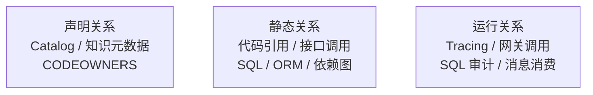

核心关系：

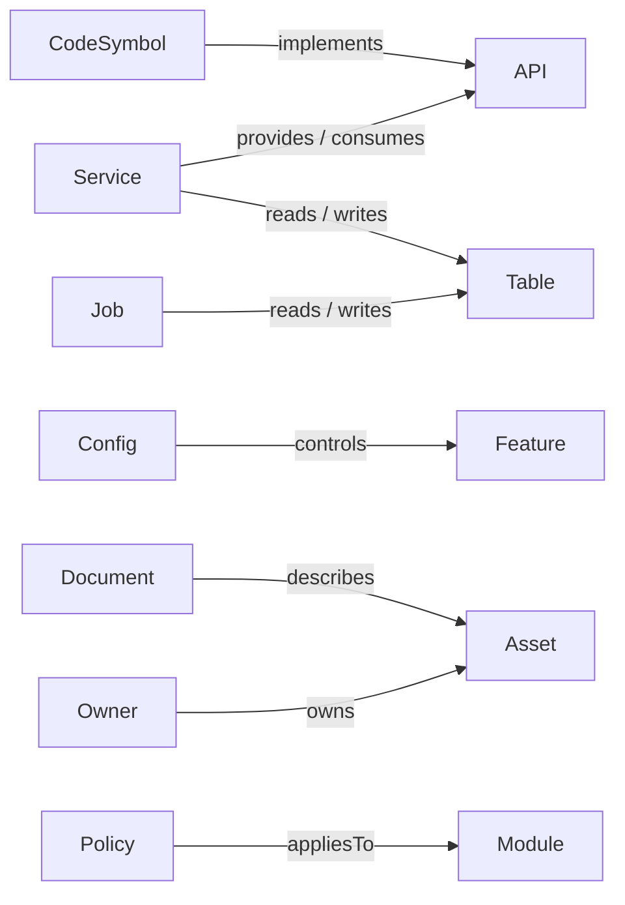

**kind 归属说明**（避免与 Backstage 原生 kind 混淆）：上图中 `Service`、`API`、`Table`（对应 Backstage `Resource`）、`System`、`Domain` 属于 Backstage **原生 kind**；而 `CodeSymbol`、`Config`、`Feature`、`Document`、`Policy`、`Module`、`Asset`、`Job`、`Owner` 是本方案的**自定义 kind**，需通过 Backstage 的自定义 kind 扩展机制注册（Backstage 原生 kind 只有 Component / API / System / Domain / Resource / Location / Group / User / Template）。自定义 kind 一旦注册，必须固化 Schema 版本，不允许在关系图中隐式新增字段。

另外，`owner_group: ocp/backend` **不是 Backstage 的实体引用格式**。若要对接 Backstage Catalog，必须写成 `group:default/ocp-backend`（`{kind}:{namespace}/{name}`）。本方案 frontmatter 使用简写形式，对接 Catalog 时由索引 Pipeline 做一次格式转换，两者不得混用。

**依据**：[Backstage Descriptor Format](https://backstage.io/docs/features/software-catalog/descriptor-format/)（原生 kind 清单与实体引用格式）、[DataHub Lineage](https://docs.datahub.com/docs/features/feature-guides/lineage/)、[OpenMetadata Lineage](https://docs.open-metadata.org/latest/how-to-guides/data-lineage)、[OpenTelemetry GenAI](https://opentelemetry.io/docs/specs/semconv/gen-ai/)

**性质**：直接依据（原生 kind 与引用格式）+ 自拟（自定义 kind 与关系集合）| **置信度**：高
**注意**：OpenTelemetry GenAI 语义约定仍处于 Development，企业内部应固定 Schema 版本。

### 8.6 接口废弃 Sunset 生命周期（决策 11）

```yaml
status: deprecated
deprecated_at:
replacement_api:
migration_guide:
sunset_at:
known_consumers:
owner_group:
```

控制要求：

- 新代码调用废弃接口时阻断。
- 存量调用按 Sunset 时间告警。
- 文档和知识条目同步标记废弃。
- 删除前确认调用方和引用清零。

**依据**：[OpenAPI](https://spec.openapis.org/oas/v3.1.2)、[RFC 8594 Sunset Header](https://www.rfc-editor.org/rfc/rfc8594)、[DataHub Lineage](https://docs.datahub.com/docs/features/feature-guides/lineage/)、[OpenMetadata Lineage](https://docs.open-metadata.org/latest/how-to-guides/data-lineage)

**性质**：工程推导 | **置信度**：高

### 8.7 知识边际价值评估（决策 31）

用于判断知识条目是否值得继续维护（P3 展开）。

#### 8.7.1 原公式的问题

「价值分 − 成本分」在数学上不可计算：价值分的三项分别是**次数**（检索频次）、**比率**（命中率）、**等级**（模块关键度），成本分是**人时/年**。量纲不同的量相减没有意义，权重也无法标定——任何权重组合都能让同一批条目得出相反的排序结论。

因此改为**统一量纲到「人时/年」**，价值侧换算为「每年节省的人时」，成本侧本就是「每年消耗的人时」，两者可直接相减。

#### 8.7.2 可计算的价值-成本模型

```text
年度价值（人时/年）
  = 年检索命中次数
  × 单次命中节省的人时
  × 命中有效率

  其中：
  年检索命中次数   ← 审计日志统计（§7.6.3 的 retrieved_chunks）
  单次命中节省的人时 ← 实测：无知识库时定位同一问题的平均耗时
                     − 有知识库时的平均耗时
  命中有效率       ← 命中后未被点踩、且未触发返工的比例（§9.3）

年度成本（人时/年）
  = 年更新次数 × 单次更新人工耗时
  + 年复核次数 × 单次复核人工耗时

  其中：
  年更新次数       ← git log 统计该条目的实际提交次数
  年复核次数       ← 由 §6.2.3 的分级复核周期决定
  单次更新/复核耗时 ← 实测抽样

边际价值 = 年度价值 − 年度成本   （单位：人时/年）
```

**三个输入项必须实测，不得拍脑袋**：「单次命中节省的人时」是整个模型最敏感的参数，它直接决定排序结果。测法：抽取一批真实问题，让两组人分别在「有知识库」与「无知识库」条件下解答，记录耗时差。这是一次性投入，之后按季度复测。

**模块关键度不进公式，而作为否决项**：关键度是等级量，无法与人时相乘。改为独立维度参与决策表（下表），避免量纲混杂。

#### 8.7.3 决策表

| 边际价值 | 模块关键度 | 模块状态 | 决策 |
| -------- | ---------- | -------- | ---- |
| 正 | 任意 | 活跃 | 正常维护 |
| 正 | 任意 | 活跃但低频 | 保留，按 §6.2.3 降低复核频率 |
| 正 | 高 | 无活跃开发 | 保留，标记为低频关键知识 |
| 正 | 低 | 无活跃开发 | 保留，延长复核周期至上限 |
| 负 | 高 | 无活跃开发 | **不归档**，转人工评审（关键度否决） |
| 负 | 低 | 无活跃开发 | 连续观察期满后归档 |
| 负 | 任意 | 模块已废弃 | 立即标记 `deprecated`，进入 Sunset（§8.6） |

**防误删保护**（三重，缺一不可）：

1. **豁免类别**：安全、合规、资金、权限相关知识**不参与边际价值评估**，永不自动归档。这类知识的价值是「避免一次事故」，无法用检索频次衡量——低频不等于低价值。
2. **关键度否决**：上表第 5 行，边际价值为负但模块关键度高时不归档。
3. **人工审批**：任何归档动作必须经 Owner 审批，系统只产出建议清单。归档后的知识仍可通过精确 `knowledge_id` 检索到（不进召回集，但不删除）。

**为什么观察期不可省略**：边际价值基于历史统计，而知识价值有滞后性——一条事故复盘知识可能一年只被检索一次，但那一次避免的是重大故障。观察期内若命中一次高价值场景（如事故归因引用），统计窗口应重置。

**依据**：[Backstage Descriptor Format](https://backstage.io/docs/features/software-catalog/descriptor-format/)（`spec.lifecycle` 生命周期状态）、[DataHub Glossary](https://docs.datahub.com/docs/features/feature-guides/business-glossary/)（术语资产的 Owner 与废弃治理）

**性质**：自拟（模型结构、量纲统一方法、三重保护均为本方案设计，无外部来源规定知识资产的边际价值算法）| **置信度**：待 §9 评测与实测验证
**待实测**：单次命中节省的人时、命中有效率、单次更新与复核耗时、观察期长度、模块关键度的分级标准。

### 8.8 度量

| 指标 | 计算方式 | 目标 | 性质（§1.3） |
| ---- | -------- | ---- | ------------ |
| 过期知识率 | 超过复核时间仍为 Active 的比例 | ≤ 10% | 阈值待实测 |
| 孤儿知识率 | 无有效责任团队的比例 | = 0 | **机制保证**（CI 校验 `owner_group` 在 GitLab 中存在，不存在即阻断合并） |
| 漂移未处理天数 | `drift_detected` 到 Owner 处理的平均天数 | ≤ 5 天 | 阈值待实测 |
| 冲突未决时长 | 冲突知识平均解决时间 | ≤ 3 天 | 阈值待实测 |
| 同步 P95 时延 | 源变更到新版本可检索的时间 | ≤ 24 小时 | 阈值待实测 |
| 删除残留率 | 源删除后仍能召回的比例 | = 0 | **机制保证**（Tombstone 处理 + 索引对账可直接判定，见 §8.2） |

---

## 9. 评测与反馈闭环

> 本阶段解决：如何度量知识体系的效果？如何从失败中持续改进？

### 9.1 四层失败归因（决策 19）

| 类型                           | 诊断问题                       | 判定方法 |
| ------------------------------ | ------------------------------ | -------- |
| Retrieval Failure              | 正确证据是否进入 Top-K         | 金标集比对：`expected_citations` 是否出现在检索结果 |
| Generation Failure             | 证据正确但答案是否错误         | 证据已在 Top-K，但输出的 claim 与证据矛盾或未被证据支持 |
| Business Understanding Failure | 是否误解术语、角色、版本或约束 | 证据正确、答案表面通顺，但违反了受控术语表（§7.2）、版本裁决（§8.1）或适用范围 |
| Execution Failure              | 代码、测试或工具操作是否错误   | 知识正确传达，但生成的代码/命令/工具调用不通过编译、测试或 Hook 校验 |

**归因顺序是串行的**：必须先排除上一层，才能归因到下一层。若正确证据未进 Top-K，即使答案也错，也只记 Retrieval Failure（否则一次检索失败会被重复计入多类，导致改进优先级误判）。同一样例允许记录一个**主归因** + 多个**次归因**，统计改进收益时只按主归因计数。

**依据**：[Microsoft RAG Evaluators](https://learn.microsoft.com/en-us/azure/ai-foundry/concepts/evaluation-evaluators/rag-evaluators)（Retrieval / Document Retrieval / Groundedness / Groundedness Pro / Relevance / Response Completeness 六个维度直接支撑前两层）、[AWS Bedrock Evaluation](https://docs.aws.amazon.com/bedrock/latest/userguide/evaluation-kb.html)、[TruLens RAG Triad](https://www.trulens.org/getting_started/core_concepts/rag_triad/)（Context Relevance / Groundedness / Answer Relevance 三元组直接支撑前两层）

**方向性依据**：[NIST AI RMF Core](https://airc.nist.gov/airmf-resources/airmf/5-sec-core/)。该页为四职能总览，**未规定任何失败分层**，只要求对 AI 风险进行度量与管理。

**性质**：**前两层有直接依据**；第三层 Business Understanding Failure 是 AI Coding 场景下对 Groundedness 的细化拆分（上述三个来源中无独立对应维度），第四层 Execution Failure 为 AI Coding 场景扩展，两层均为**自拟** | **置信度**：前两层高，后两层待 §9 评测集验证

### 9.2 评测集体系（决策 20）

初期可建设 100～300 条样例：

- 固定金标集
- 线上失败集
- 权限和越权集
- 精确标识符集
- 新旧版本冲突集
- 无答案和拒答集
- 多跳影响分析集
- AI Coding 规则集

```yaml
query:
expected_intent:
authorized_scope:
reference_contexts:
expected_answer_or_rubric:
knowledge_versions:
expected_citations:
expected_action:
risk_level:
```

**依据**：[AWS Bedrock Evaluation](https://docs.aws.amazon.com/bedrock/latest/userguide/evaluation-kb.html)、[RAGAS Eval Dataset](https://docs.ragas.io/en/stable/concepts/components/eval_dataset/)、[NIST AI RMF Manage](https://airc.nist.gov/airmf-resources/playbook/manage/)

**性质**：工程推导 | **置信度**：高
**待实测**：样本规模、风险层级阈值和回归频率。

### 9.3 反馈闭环（决策 21）

反馈先归因和审核，不能直接写回正式知识库：


各环节自动化程度：

| 步骤 | 自动化程度 | 说明 |
|------|------------|------|
| 脱敏 | 全自动 | 正则 + NER 识别敏感实体，自动替换 |
| 聚类和去重 | 全自动 | 向量相似度 + 主题聚类 |
| 四层失败归因 | 半自动 | AI 提议分类，Owner 审核确认 |
| 修知识/索引/规则 | 半自动 | AI 生成草稿，Owner 审批后入库 |
| 加入动态回归集 | 全自动 | 归因确认后自动进入回归评测集 |
| 知识边际价值评估 | 半自动 | 系统统计数据，Owner 判断是否归档 |

**依据**：[NIST AI RMF Manage](https://airc.nist.gov/airmf-resources/playbook/manage/)、[OWASP RAG Security](https://cheatsheetseries.owasp.org/cheatsheets/RAG_Security_Cheat_Sheet.html)、[OpenAI Harness](https://openai.com/index/harness-engineering/)

**性质**：工程推导 | **置信度**：高

### 9.4 工程基线指标（决策 22）

不预设 AI Coding 提升百分比，先建立工程基线：

- 首次 CI 通过率
- 契约测试通过率
- Review 缺陷数
- 人工重写比例
- Review 后提交轮次
- 缺陷逃逸率
- 回滚率
- 首个可评审 MR 耗时
- Time to Merge
- Change Lead Time
- 每个成功任务的人类介入时间
- 每个成功任务的模型成本

**为什么「不预设提升百分比」是刻意设计**：公开复盘（如 OpenAI 关于 Codex 的 harness engineering 实践）确实报告了产出规模数字。但这些数字来自特定团队、特定代码库、特定时间窗，**把外部数字抄成本团队的验收线，等于用一个无法验证的承诺替代基线测量**。因此本方案只建立基线，收益由 §9.2 评测集与线上环比自证。

**依据**：[DORA Metrics](https://dora.dev/guides/dora-metrics/)（Change Lead Time、回滚率等有直接定义）、[GitHub Copilot Metrics](https://docs.github.com/en/copilot/concepts/copilot-metrics)（AI 辅助编码的指标口径）、[GitLab Duo Trends](https://docs.gitlab.com/user/analytics/duo_and_sdlc_trends/)

**性质**：指标清单为工程推导（DORA 部分有直接依据）；「不预设提升百分比」为本方案的方法论立场，**无外部来源支持该立场本身** | **置信度**：高（指标定义）/ 自拟（立场）

### 9.5 评测执行细则（决策 29）

> §9.2 定义了八类评测集，§9.1 定义了归因分层，但**没有说明这些评测集怎么产生、谁标注、标注不一致怎么办、LLM 判官能不能信**。缺了这一层，评测集会退化成「开发者随手写的几条 query」，§9 的全部指标随之失去意义。

#### 9.5.1 金标集标注流程

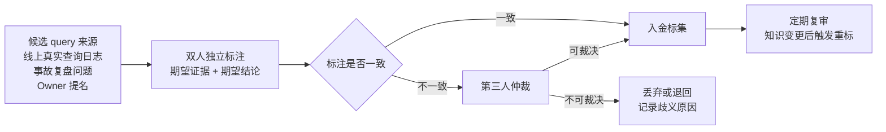

四条纪律：

1. **query 必须来自真实场景**，不得由开发者凭想象编写。想象的 query 分布与线上分布差异极大，用它调出的参数在线上无效。
2. **标注「期望证据」而非「期望答案文本」**。答案文本会随模型与知识修订变化，证据引用（`chunk_ref`）相对稳定。这也是 §7.4.1 采用内容寻址的直接受益方——若 `evidence_id` 用 chunk 序号，每次重新切分都会让金标集作废。
3. **不可裁决的 query 必须丢弃并记录原因**。强行保留会让评测结果长期噪声化。歧义原因本身是知识缺口的信号，应回流到 §9.3 反馈闭环。
4. **知识变更后触发重标**：被引用条目 `deprecated` 或 `source_revision` 变更时，相关金标样例进入复审队列，否则评测集会静默过期。

#### 9.5.2 标注一致性度量

双人标注必须量化一致性，否则「一致」只是主观判断：

| 标注对象 | 一致性指标 | 说明 |
| -------- | ---------- | ---- |
| 期望证据集合 | Cohen's Kappa / Krippendorff's Alpha | 类别型判断，须扣除随机一致 |
| 归因层级（§9.1 四层） | Cohen's Kappa | 四层为互斥类别 |
| 答案质量评分 | 加权 Kappa 或 ICC | 有序等级评分，需加权 |

**Kappa 低于阈值时，先修标注指南再重标，不得直接进入仲裁**。指南不清导致的分歧会持续产生，仲裁成本远高于重写指南。阈值须实测确定（见 §14）。

#### 9.5.3 LLM-as-Judge 的偏差控制

`Faithfulness`（§7.8）等指标依赖 LLM 判官。**未经验证的判官等于把评测建立在另一个不可信组件上**：

| 偏差 | 表现 | 控制手段 |
| ---- | ---- | -------- |
| 位置偏差 | 倾向选择靠前/靠后的候选 | 交换顺序各评一次，结果不一致则记为「判官不确定」 |
| 长度偏差 | 倾向认为更长的答案更好 | 评分维度中显式排除长度；提供等长对照样例 |
| 自我偏好 | 倾向认可同族模型生成的内容 | 判官模型与生成模型**不同族** |
| 权威腔偏差 | 措辞自信即判为正确 | 判官只看「claim 是否被 evidence 支持」，不评措辞 |
| 格式偏差 | 结构化输出得分偏高 | 评分规则中固定格式权重为零 |

**判官必须先通过人工一致性校准**：取一批已有人工标注的样例，计算判官与人工的一致性（Kappa）。**判官一致性未达标前，其产出的指标只能观测，不得作为门禁**——这与 §1.3「阈值待实测」的处置一致。

**依据**：[Google Vertex AI Rubric-based Metrics](https://docs.cloud.google.com/vertex-ai/generative-ai/docs/models/rubric-metric-details)（基于评分细则的 LLM 评估方法）、[Microsoft RAG Evaluators](https://learn.microsoft.com/en-us/azure/ai-foundry/concepts/evaluation-evaluators/rag-evaluators)（Groundedness / Groundedness Pro 的判官口径）、[RAGAS](https://arxiv.org/abs/2309.15217)（Faithfulness 等指标的原始定义）

#### 9.5.4 回归集是否作为合并门禁

| 变更类型 | 回归集角色 | 理由 |
| -------- | ---------- | ---- |
| 检索参数调整（k、Top-K、rerank 阈值） | **硬门禁**，不通过不得合并 | 直接影响 Recall@K，且可快速验证 |
| Embedding 模型升级 | **硬门禁** + 双索引对比（§6.6.4） | 影响全量向量，回滚成本高 |
| 切分策略变更 | **硬门禁** | 影响 `chunk_hash` 与全部引用可解析性 |
| 单条知识内容修订 | 软门禁，失败仅告警 | 单条变更影响面小，硬门禁会拖慢知识更新 |
| 知识条目新增 | 不设门禁 | 新增不影响既有召回（除非引入重复，由 §4.1 拦截） |

**为什么不对所有变更设硬门禁**：知识库的价值在于更新速度。全量硬门禁会让一次错别字修订也要跑完整评测，最终结果是团队绕过门禁——**过严的门禁等于没有门禁**。

#### 9.5.5 离线评测与线上 A/B 的分工

| 维度 | 离线评测集 | 线上 A/B |
| ---- | ---------- | -------- |
| 能回答 | 检索与引用的正确性是否退化 | 用户实际是否更愿意采纳 |
| 不能回答 | 用户真实满意度、采纳率 | 为什么退化（须回到离线归因） |
| 成本 | 低，可每次合并运行 | 高，需流量与周期 |
| 使用时机 | 全部检索/索引/模型变更 | 重大架构变更、判官校准后的指标验证 |

线上指标（点踩率、返工率、人工介入时长）与离线指标（Recall@K、Faithfulness）**不可互相替代**。离线全绿但线上点踩率上升，说明评测集分布已偏离真实查询——此时应重新采样 query（§9.5.1 第 1 条），而不是继续调参。

**性质**：标注流程与门禁分级为工程推导；LLM-as-Judge 偏差清单有直接依据（Vertex Rubric Metrics、RAGAS） | **置信度**：中高
**待实测**：Kappa 达标阈值、判官与人工一致性的达标阈值、回归集规模、A/B 所需流量与周期。

### 9.6 度量

| 指标 | 计算方式 | 目标 | 性质（§1.3） |
| ---- | -------- | ---- | ------------ |
| 反馈归因覆盖率 | 已归因反馈 / 总反馈数 | ≥ 80% | 阈值待实测 |
| 同类问题复发率 | 归因修复后同类问题再次出现的比例 | ≤ 5% | 阈值待实测 |
| 回归集通过率 | 每次版本迭代后回归测试的通过比例 | ≥ 95% | 阈值待实测（回归集自身规模须先达标，见 §9.5） |
| 基线改善趋势 | 各工程基线指标的月度环比 | 持续正向 | 趋势指标 |

---

## 10. 约束执行

> 本阶段解决：如何确保 AI 在知识约束范围内行动？

### 10.1 三层控制框架（决策 23）

**10.1.1 指导、执行、裁决三层控制（决策 23.1）**

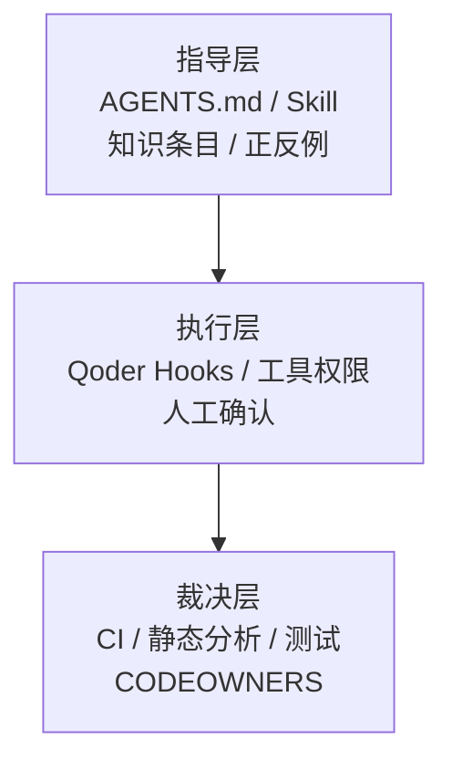

Qoder Hook 分**两种形态，能力不同，落地前必须区分**：

| 能力 | Qoder CLI（`cli/hooks-reference`） | Qoder IDE 扩展（`extensions/hooks`） |
| ---- | ---------------------------------- | ------------------------------------ |
| Hook 类型 | `command` / `http` / `prompt` / `agent` | **仅** `command` / `http` |
| `FileChanged` 事件 | 支持 | **不支持** |
| `WorktreeCreate` / `WorktreeRemove` | 支持 | **不支持** |
| 阻断方式 | `command` 退出码 2（stderr 回灌模型）；`prompt` / `agent` 返回阻断决策 | `command` 退出码 2 |

因此：**10.1.4 的 Worktree 隔离与基于文件变更的知识漂移触发，只在 CLI 形态可用**；若团队实际使用 IDE 形态，这两条必须降级为 CI 侧实现（GitLab 流水线 + `changes:` 规则）。共有事件为 `PreToolUse`、`PostToolUse`、`UserPromptSubmit`、`SessionStart`、`Stop`、`SubagentStart/Stop`（IDE 侧共 12 个事件）。

**10.1.2 高价值规范编译为四件套（决策 23.2）**

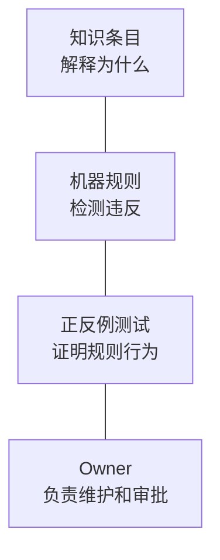

示例：

```text
规范：Controller 不得直接依赖 DAO
知识：解释分层原因
规则：ArchUnit
反例：Controller → DAO，测试失败
Owner：backend-architecture
```

**10.1.3 Impact Manifest（决策 23.3）**

接口和 DDL 修改前必须生成 Impact Manifest：

```yaml
base_commit:
knowledge_revision:
changed_assets:
affected_services:
affected_consumers:
compatibility_risks:
migration_risks:
required_tests:
required_approvers:
rollback_plan:
```

Impact Manifest 是继续执行的前置条件，但不能替代静态分析和测试。

**10.1.4 Worktree 隔离（决策 23.4）**

多个 Agent 使用独立 Worktree，并绑定基线版本：

- 每个 Agent 使用独立 Worktree 和 Branch。
- 记录基础 Commit 和知识版本。
- 声明读取集和写入集。
- 公共契约采用单写者或显式串行化。
- 知识更新使用 `expected_revision` 乐观锁。
- 合并前统一 Rebase、冲突检测和全量测试。
- 不允许多个 Agent 并发覆盖同一工作目录。

**10.1.4 依据**：[Git Worktree](https://git-scm.com/docs/git-worktree)（工作区隔离机制）、[Qoder Hooks（CLI）](https://docs.qoder.com/cli/hooks-reference)（`WorktreeCreate` / `WorktreeRemove` 事件，**IDE 形态不支持，见 §10.1.1 的形态对比表**）、[SLSA Provenance v1.2](https://slsa.dev/spec/v1.2/provenance)（基线版本与读写集声明的可追溯性）

**10.1.4 性质**：直接依据（Worktree 机制）+ 自拟（读写集声明、`expected_revision` 乐观锁、单写者契约） | **置信度**：中高

**10.1.1–10.1.3 依据**：[Qoder Hooks](https://docs.qoder.com/cli/hooks-reference)、[GitLab Code Owners](https://docs.gitlab.com/user/project/codeowners/)、[OpenAI Harness](https://openai.com/index/harness-engineering/)、[Semgrep Rules](https://semgrep.dev/docs/writing-rules/overview)、[NIST SSDF](https://doi.org/10.6028/NIST.SP.800-218)、[OpenAPI](https://spec.openapis.org/oas/v3.1.2)、[Flyway Validate](https://documentation.red-gate.com/fd/validate-277578898.html)、[Liquibase Checksums](https://docs.liquibase.com/concepts/changelogs/changeset-checksums.html)、[DataHub Lineage](https://docs.datahub.com/docs/features/feature-guides/lineage/)

**10.1.1–10.1.3 性质**：直接依据 + 工程推导 | **置信度**：中高
**注意**：实际 Hook 事件输入和阻断范围需按企业部署版本验收，且**必须先确认是 CLI 还是 IDE 形态**（§10.1.1）。Worktree 只解决工作区隔离，不能自动解决语义冲突，仍需契约锁、依赖 DAG 和合并门禁。

### 10.2 度量

| 指标 | 计算方式 | 目标 | 性质（§1.3） |
| ---- | -------- | ---- | ------------ |
| 一次 CI 通过率 | AI 代码首次通过确定性门禁的比例 | ≥ 80% | 阈值待实测 |
| 返工率 | AI 结果被人工大幅修改的比例 | ≤ 15% | 阈值待实测（「大幅修改」须先定义可计算口径，见 §9.5） |
| Hook 拦截率 | 被 Qoder Hook 阻断的操作 / 总操作数 | 趋势下降 | 趋势指标 |
| 影响分析覆盖率 | API/DDL 变更识别到相关资产的比例 | ≥ 90% | 阈值待实测 |

---

## 11. 成熟度模型与组织落地

### 11.1 成熟度模型（决策 24）

> 决策 24：按成熟度逐步建设，不先上完整 GraphRAG。

| 阶段 | 建设目标 | 主要能力                       | 该阶段必须同时具备的安全与审计能力 |
| ---- | -------- | ------------------------------ | ---------------------------------- |
| L0   | 可搜索   | 聚合知识、目录、基础检索       | `classification` 字段落库；检索前按密级过滤（§7.6） |
| L1   | 可溯源   | 来源、版本、Chunk 引用、拒答   | 检索审计日志开启；引用可解析率可统计 |
| L2   | 可治理   | Owner、生命周期、漂移治理      | 越权访问告警；Owner 变更留痕 |
| L3   | 可约束   | Hook、Lint、测试、CI 门禁      | 阻断事件全量留痕并可回溯到 trace_id |
| L4   | 变更驱动 | MR、API、DDL 自动影响分析      | 影响分析结果纳入审计，供事故归因 |
| L5   | 持续自证 | 评测、反馈、收益和熵治理       | 评测集含权限越权集，回归门禁覆盖安全用例 |

**安全不是最后阶段的能力**：密级过滤属于 L0，因为一旦无过滤的知识先被 Agent 消费，事后补权限无法撤销已经泄露的内容。这是把 §7.6 的检索前密级过滤提前到 P0 的原因（见附录）。

**依据**：[OpenAI Harness](https://openai.com/index/harness-engineering/)、[Anthropic Context Engineering](https://www.anthropic.com/engineering/effective-context-engineering-for-ai-agents)、[Microsoft Research GraphRAG](https://www.microsoft.com/en-us/research/publication/from-local-to-global-a-graph-rag-approach-to-query-focused-summarization/)、[OWASP RAG Security](https://cheatsheetseries.owasp.org/cheatsheets/RAG_Security_Cheat_Sheet.html)（Access Control Inheritance、Fail-Closed Design 支撑「安全前置」结论）

**方向性依据**：[NIST AI RMF Core](https://airc.nist.gov/airmf-resources/airmf/5-sec-core/)。该页为四职能总览，**未定义任何成熟度分级**；L0–L5 的分级、各级能力边界与安全前置要求均为本方案**自拟**。

**性质**：成熟度分级为自拟；安全前置结论有直接依据（OWASP Fail-Closed） | **置信度**：高（安全前置）/ 自拟（分级）

### 11.2 冷启动路径（决策 32）

> 决策 32：冷启动按「先读后写」推进——第一批价值来自让存量知识可检索，而不是让团队写新条目。

**为什么不能先要求写作**：写一条合格知识的成本落在作者身上，收益落在读者身上，而读者通常是未来的、不确定的、看不见的人（§11.3）。冷启动阶段就派发写作任务，收到的必然是凑数内容，而这些内容立刻成为 §8.7 定义的负价值知识——它们会稀释检索精度，且清理成本高于当初的写作成本。

**分四期推进**：

| 期 | 目标 | 做什么 | 明确不做什么 |
| -- | ---- | ------ | ------------ |
| C0 | 可检索 | Git Markdown 摄入（§3.5）+ Confluence/Wiki/PDF 解析 + 元数据最小集由 CI 自动回填 + 只读检索上线 | 不要求任何人写新条目；不建全量分类体系 |
| C1 | 有需求证据 | 开启审计日志（§7.6.3），统计 `refusal` 与低召回 query，形成种子知识清单 | 不靠「哪个团队愿意配合」选题 |
| C2 | 核心域跑通 | 选 1–2 个种子域补齐知识，打通 Owner 复核与漂移告警闭环 | 不追求覆盖率指标 |
| C3 | 规模化 | 全量迁移、关系图谱（§8）、评测回归门禁（§9） | — |

**种子域选择判据**（三条同时满足）：AI Coding 场景在该域的占比高；该域有明确的 Owner 团队（否则 §5.1 的责任制无法落地）；存量文档相对集中（解析成本可控）。

**迁移顺序不按目录树，按 C1 的 query 命中缺口**。按目录迁移的结果是：最容易迁的（格式规整的旧设计文档）先被迁完，而这些恰恰是查询最少、最可能已过期的部分。

**冷启动常见反模式**：

| 反模式 | 为什么会失败 |
| ------ | ------------ |
| 先建全量分类体系再填内容 | 分类体系会随实际内容变形，先建的必然返工，且返工期间目录不可用 |
| 先要求每团队交 N 篇 | 交上来的是凑数内容；配额一旦达成，后续再无人主动写 |
| 先上 GraphRAG | 无实体无关系可抽取；L5 能力建立在 L0 数据上无意义（§11.1） |
| 把「存量迁移完成」当冷启动完成判据 | 迁移完成只证明可搜索，不证明有人在用 |

**冷启动完成判据**：审计日志中 `refusal` 率与低召回 query 数可统计（机制保证——只要有日志即成立）；种子域的核心问题能引用回源（阈值待实测）；**至少一个非平台团队成员主动提交过知识 MR**（趋势指标，且是唯一能证明激励跑通的信号，见 §11.3）。

### 11.3 组织运营与角色（决策 33）

> 决策 33：知识运营设四类角色，且写作激励必须与阅读收益解耦——不靠「提高重视程度」维持知识库。

**角色划分**：

| 角色 | 职责 | 归属 | 兼任约束 |
| ---- | ---- | ---- | -------- |
| 知识 Owner | 单条目内容正确性、周期复核、漂移处理 | 条目对应模块的负责团队 | **不得为平台组**——平台组不了解业务语义，代管等于无人负责 |
| 知识 Steward | 目录结构、受控术语表、条目模板、元数据 Schema 演进、CODEOWNERS 维护 | 每租户各一套 | **不得同时是该域的审批人**，否则自审自批（§5.2） |
| 平台组 | 摄入链路、索引、检索服务、权限过滤、审计、评测流水线 | 共享 | — |
| 知识园艺 | 周期扫描孤儿/过期/低边际价值条目，产出待处理清单 | 平台组 Agent + 人工确认 | **不得有自动删除权**（§8.7.3 三重防误删） |

**激励不对称是知识库衰败的根因**，不是「大家不重视」。因此四条设计原则：

1. **不要把「写知识」当额外任务派发**。派发出来的必然是凑数内容（§11.2）。
2. **嵌进本来就要做的动作**：MR 描述、ADR、事故复盘、评审结论由摄入链路自动转化为条目草稿（§3.2、§3.5），人只做确认与补充，不做从零写作。
3. **收益必须回流给作者**：条目被检索命中次数、被 Agent 引用次数按 Owner 可见。数据源已存在——§7.6.3 的审计日志含 `retrieved_chunks`，无需新增埋点。
4. **反向指标比正向指标可靠**：「因知识缺失导致的返工与事故」比「写了多少篇」更能说明价值，也更容易获得管理层持续投入。正向指标可以被凑数刷高，反向指标不能。

**多租户 / 多 BU 共用一套实例时的隔离层次**：

| 维度 | 隔离要求 | 理由 |
| ---- | -------- | ---- |
| 索引 | 每租户独立 collection / index，**不靠 metadata 过滤** | metadata 过滤一旦漏写即跨租户泄露；与 §7.6.1 的「检索前过滤」是同一原则的租户版 |
| 受控术语表 | 租户内受控；全局术语表只放真正共用的术语 | 同一术语在不同 BU 可能语义相反，全局共享会污染 §7.6 的查询改写 |
| 评测集 | 金标集不得跨租户共享 | 金标集含真实业务 query 与答案（§9.5.1） |
| 审计与配额 | 按租户归集，成本分租户核算 | §12.3 成本模型需要租户维度才能定价与限流 |
| 平台组 / Steward | 平台组共享，Steward 每租户各一套 | 平台是技术设施可复用，目录与术语是业务语义不可复用 |

**P0 人力估算：本方案不给数字，只给最易低估的三项**。任何具体人日数都必须按 §14 的方式先做小样本实测再外推，因为下面三项的规模完全取决于本团队存量状态：

1. **存量文档的脏数据比例**——§13 中「解析成功率 ≥ 95%」是目标值而非现状，首轮实测通常远低于此，返工量由脏数据形态（扫描版 PDF、表格截图、失效内链）决定。
2. **权限映射清洗**——把现有 IAM 组结构映射为 `acl_groups`（§7.6.1）的工作量，取决于历史授权是否已经混乱；这一项在实践中经常超过整条摄入链路的开发量。
3. **金标集标注**——需要业务专家时间，平台组无法自己完成（§9.5.2），且专家时间是全项目最稀缺的资源。

**培训与上手**：

- **不需要培训「怎么用知识库」**。用户侧入口是 Agent，用户感知不到知识库存在——这正是 §7.7 接口设计的意图。若需要培训用户，说明接口设计失败了。
- **需要培训的是 Owner 侧**：frontmatter 必填字段、复核触发条件、漂移告警的处理动作。
- **上手成本判据**：一个新 Owner 能在不查文档的情况下完成「收到漂移告警 → 确认 → 更新条目 → 合并」的闭环。做不到说明模板或告警文案有问题，**应改工具而不是加培训**。

**依据**：[Backstage](https://backstage.io/docs/features/software-catalog/descriptor-format)（Component/System/Domain 原生 kind 与 `spec.owner` 归属模型，支撑「Owner 归属业务团队而非平台组」）、[GitLab CODEOWNERS](https://docs.gitlab.com/user/project/codeowners/)（责任到人的机制载体，§5.1）、§7.6.3 审计日志字段（`refusal`、`retrieved_chunks` 为冷启动选题与激励回流提供数据来源）

**性质**：冷启动四期划分、角色兼任约束、多租户隔离层次、培训判据均为**自拟**；「激励不对称导致知识库衰败」为工程推导，无外部量化依据；索引不靠 metadata 过滤由 §7.6.1 检索前过滤原则推导 | **置信度**：中（角色划分有 Backstage 同类实践支撑）/ 自拟（冷启动分期、人力模型）

**注意**：本章刻意不给出任何人日数字或激励系数。P0 人力必须实测；三项易低估点是定性提示，**不是可直接引用的估算系数**。

### 11.4 度量

| 指标 | 计算方式 | 目标 | 性质（§1.3） |
| ---- | -------- | ---- | ------------ |
| 种子域覆盖率 | 种子域内已有条目的核心问题数 / 审计日志中该域的去重 query 数 | 阈值待实测 | 阈值待实测 |
| 拒答率 | `refusal` 交互数 / 总交互数 | 先降后稳 | 趋势指标 |
| 主动提交率 | 非平台团队成员提交的知识 MR / 全部知识 MR | 趋势上升 | 趋势指标（冷启动完成的唯一硬信号，§11.2） |
| Owner 响应时长 | 漂移告警到 Owner 处理的平均时长 | ≤ 5 天（与 §13「漂移未处理天数」同口径） | 阈值待实测 |
| 知识复用度 | 单条目年检索命中次数的分布 | 只观测分布，无绝对目标 | 趋势指标（§8.7 边际价值模型的输入） |
| 孤儿知识率 | 见 §13 | = 0 | 机制保证 |


---

## 12. 非功能性设计与部署选型（决策 30）

> 前面 11 章回答「知识库应该有什么能力」，本章回答「这套系统怎么跑得起来、跑得起多久、要花多少钱」。**容量、可用性、成本三项缺失，方案在评审时无法通过**——因为它们决定了 P0 到底能不能落地，而不只是落地得好不好。

### 12.1 容量与规模量级

规模决定选型。下表的**量级划分是设计输入**，具体数值必须由本团队按实际语料测算后填入（见 §14），此处不预设：

| 规模档位 | 知识条目数 | 向量数（含切分放大） | 典型部署形态 |
| -------- | ---------- | -------------------- | ------------ |
| 小型 | 千级 | 万级 | 单机 pgvector，与业务库同实例 |
| 中型 | 万级 | 十万级 | 独立向量库单集群 + ES 混合检索 |
| 大型 | 十万级以上 | 百万级以上 | 向量库分片集群 + 独立 Embedding 服务 |

**切分放大系数必须实测**：一条知识条目按 §6.4 切分后产生的 chunk 数不是常数，它取决于文档长度分布。若按「1 条 = 3 chunk」估算而实际是 8，向量存储与 Embedding 成本会偏差数倍，**且这个偏差在 P0 阶段就会暴露**。因此容量测算的第一步是：对现有语料做一次完整切分，统计 chunk 数分布（均值 / P90 / 最大值），再乘以上下文前缀带来的长度增量（§6.6.1）。

QPS 与并发：

| 调用来源 | 流量特征 | 设计影响 |
| -------- | -------- | -------- |
| 开发者交互式提问 | 低频、突发、延迟敏感 | 决定 P95 目标（§7.8） |
| Agent 自动检索（编码中） | **高频、批量、每任务多次** | 决定容量上限，是主要负载来源 |
| CI / Hook 校验 | 与 MR 量正相关、可排队 | 可异步，不进延迟预算 |
| 索引构建与重建 | 周期性、CPU/GPU 密集 | 必须与在线检索资源隔离 |

**关键判断**：Agent 自动检索的量级通常远高于人的提问量级——一次编码任务可能触发数十次知识检索。**若按「团队人数 × 人均提问数」估算容量，会严重低估**。容量必须按「并发 Agent 数 × 每任务检索次数」估算。

### 12.2 部署架构

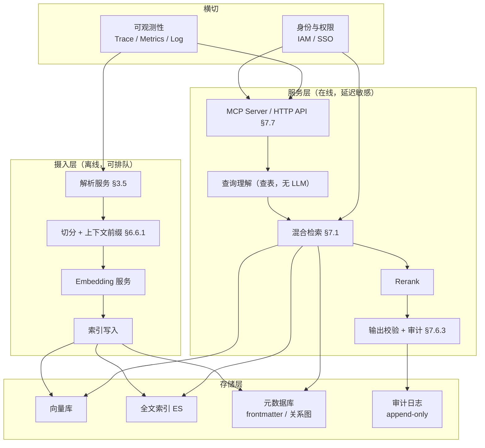

三条架构约束：

1. **摄入层与服务层资源隔离**。索引重建是 CPU/GPU 密集操作，与在线检索争抢资源会直接击穿 P95。重建应能限流、可暂停。
2. **Embedding 服务是单点依赖**，必须配熔断与降级（§12.4）。
3. **审计日志独立存储**，不与业务元数据同库（§7.6.3 纪律 1）。

### 12.3 高可用与降级策略

**核心原则：知识库不可用时，Agent 必须知道自己「没有知识」，而不是继续凭记忆生成**。这是 Fail-Closed 在系统层的体现（OWASP RAG Security 第 14 类威胁 Fail-Closed Design，映射见 §7.6.2）。

| 故障 | 降级行为 | 用户可见结果 |
| ---- | -------- | ------------ |
| 向量库不可用 | 降级为 BM25 + Exact 双通道 | 提示「语义检索暂不可用，结果可能不完整」 |
| 全文索引不可用 | 降级为向量单通道，**精确标识符查询直接拒答** | 提示；标识符类问题不猜 |
| Rerank 服务不可用 | 跳过 rerank，用融合分数 | 无提示（质量下降但不误导） |
| Embedding 服务不可用 | 摄入侧排队重试；在线侧不影响（用已有向量） | 索引延迟上升，触发 §6.7 告警 |
| 权限服务不可用 | **全量拒答**，不降级为无过滤 | 提示「权限校验失败，暂停知识检索」 |
| 元数据库不可用 | 拒答（无法校验 status 与 effective 区间） | 提示 |
| 审计日志写入失败 | **拒绝服务**（§7.8 审计完整率 = 100% 是机制保证） | 提示 |

最后两行是刻意的强约束：权限与审计失败时继续服务，等于在无管控状态下输出高密级内容且无法追溯。**可用性与合规冲突时，本方案选择合规**。这个取舍必须写入方案并在评审时明确确认，不能留到故障时临时决定。

### 12.4 备份、容灾与恢复目标

| 对象 | 备份方式 | 恢复手段 | 说明 |
| ---- | -------- | -------- | ---- |
| 知识原文（Git） | Git 自身即多副本 + 远端仓库 | `git clone` | **这是唯一不可再生资产，优先级最高** |
| 元数据库 | 定期快照 + WAL/日志 | 快照恢复 + 重放 | 可从 Git 全量重建（§6.1 派生索引原则） |
| 向量索引 | 不备份 | **从 Git 全量重建** | 备份成本高且易过期，重建更可靠 |
| 全文索引 | 不备份 | 从 Git 全量重建 | 同上 |
| 审计日志 | 异地归档，仅追加 | 归档恢复 | **不可重建**，丢失即永久丢失 |
| 评测集与金标标注 | 纳入 Git 版本管理 | `git clone` | 人工标注成本极高，必须版本化 |

RPO / RTO 的设定依据是「可重建性」而非「重要性」：

- **向量与全文索引**：RPO 无意义（可从 Git 完全重建），RTO = §6.7 的索引重建时间。
- **审计日志**：RPO 必须趋近 0（仅追加、异地同步），因为不可重建。
- **评测集**：RPO = 0（Git 提交即备份）。

**「索引不备份、只重建」是本方案的关键取舍**：它把容灾问题转化为「重建够不够快」，从而让 §6.7 的索引重建时间从一个性能指标升级为**容灾指标**。若重建时间不可接受，才需要引入索引备份——顺序不能反。

### 12.5 成本模型

成本分三类，**必须分别核算**，否则「知识库很贵」或「知识库很便宜」都是无法验证的说法：

| 成本类别 | 构成 | 驱动因子 | 优化手段 |
| -------- | ---- | -------- | -------- |
| **一次性建设** | 人力（解析、索引、权限、评测集标注） | 存量文档规模、来源种类数 | 分期建设（§11.1 成熟度、§11.2 冷启动）；先做核心域；三项最易低估的人力见 §11.3 |
| **持续运行** | Embedding 调用、Rerank 推理、LLM 判官、存储、检索算力 | chunk 总数 × 重建频率；在线 QPS | Prompt Caching（§6.6.1）；增量索引而非全量重建 |
| **治理人力** | 审批、漂移处理、冲突裁决、复核 | `active` 条目数 × 复核频率（§6.2.3） | 边际价值评估（§8.7）淘汰低价值条目 |

三个容易被漏算的成本项：

1. **上下文前缀的 LLM 成本**（§6.6.1）：每次索引构建都要为每个 chunk 调用 LLM 生成前缀。**这是全量重建时最大的单项 token 消耗**，必须用 Prompt Caching 缓存文档级上下文，否则重建成本会超出预期一个量级。
2. **LLM-as-Judge 的评测成本**（§9.5.3）：判官调用量 = 评测集规模 × 每次评测的 claim 数 × 偏差控制的重评次数（位置偏差需交换顺序各评一次，即 ×2）。若回归集作为合并门禁（§9.5.4），这笔成本按 MR 频次发生。
3. **双索引期间的成本翻倍**（§6.6.4）：模型迁移期存储与写入同时翻倍，必须限定迁移窗口长度。

**成本约束应反向影响设计**：若治理人力成本不可承受，说明 §6.2.3 的复核周期过密或知识条目过多，应通过 §8.7 边际价值评估收敛规模，而不是降低复核标准。

### 12.6 自建与选型的取舍

| 路线 | 代表 | 优势 | 代价与风险 |
| ---- | ---- | ---- | ---------- |
| 云托管 RAG 服务 | AWS Bedrock Knowledge Bases、Google Vertex AI RAG、Azure AI Search | 摄入/切分/索引/检索开箱即用，运维成本低 | **元数据 Schema 与权限模型受服务方约束**；本方案的 §6.2 治理字段、§7.6 Chunk 级 ACL 未必能完整表达 |
| 开源 RAG 平台 | RAGFlow、Dify、FastGPT | 部署快，含 UI | 治理生命周期（审批、漂移、废弃、冲突裁决）通常缺失，需二次开发 |
| 框架自建 | LlamaIndex、Haystack | 完全可控，能精确实现本方案全部控制点 | 全部工程量自担；权限、审计、评测都需自建 |

**判断依据不是「哪个更好」，而是「哪个能承载 §6.2 + §7.6」**：

- 本方案的核心价值在**治理控制面**（状态机、Owner、漂移、版本裁决）与**可信输出**（引用、拒答、权限），这两项恰好是通用 RAG 产品最弱的部分。
- 因此推荐路径：**检索与索引能力优先用成熟组件（ES / 向量库 / 云检索服务），治理控制面与引用校验层自建**。治理层是薄的（元数据 + CI 脚本 + 审批流），自建成本可控；检索层是厚的，自建性价比低。
- 若选择云托管服务，必须在选型阶段验证三件事：能否写入自定义元数据字段、能否在检索前做权限过滤（pre-filtering）、能否返回稳定的 chunk 标识。**任一项不满足，本方案的关键控制就无法落地**。

**依据**：[AWS Bedrock Knowledge Bases](https://docs.aws.amazon.com/bedrock/latest/userguide/knowledge-base.html)、[Google Vertex AI RAG Engine](https://docs.cloud.google.com/vertex-ai/generative-ai/docs/rag-engine/rag-overview)、[Azure AI Search](https://learn.microsoft.com/en-us/azure/search/search-what-is-azure-search)、[LlamaIndex](https://docs.llamaindex.ai/)、[Haystack](https://docs.haystack.deepset.ai/docs)

**性质**：成本分类与「治理层自建、检索层复用」的取舍为工程推导；产品能力边界须按选型时的实际版本验证 | **置信度**：中高
**待实测**：全部容量数值、chunk 切分放大系数、QPS 峰值、重建时间、三类成本的实际金额、云服务的元数据与权限能力验证结果。

---

## 13. 验收指标汇总

**门禁分级是本章的核心**：只有性质为「机制保证」的指标可以在 P0 直接作为硬门禁；「阈值待实测」的指标在按 §14 完成校准前**只能观测，不得阻断**（§1.3）。此前版本把全部 12 项并列写成验收线，等于用一批未校准的数字去卡合并，结果必然是团队绕过验收。

| 阶段 | 指标 | 含义 | 目标 | 性质 | 可否作 P0 硬门禁 |
| ---- | ---- | ---- | ---- | ---- | ---------------- |
| 生成 | 知识识别覆盖率 | 已有知识条目覆盖的模块数 / 总活跃模块数 | ≥ 80% | 阈值待实测 | 否，先观测 |
| 生成 | 解析成功率 | 成功解析并入库的源文档数 / 尝试解析数 | ≥ 95% | 阈值待实测 | 否，先观测 |
| 验证 | AI 审核通过率 | 首次提交即通过全部 Error 检查的 MR 比例 | ≥ 85% | 阈值待实测 | 否，先观测 |
| 验证 | 符号可解析率 | 符号级引用能在 source_revision 中解析的比例 | 100% | 机制保证 | **是** |
| 审批 | 审核周期 | MR 提交到合并的平均时间 | ≤ 2 工作日 | 阈值待实测 | 否，先观测 |
| 存储 | 索引完整性 | 索引条目数 / `active` 条目数 | 100% | 机制保证 | **是** |
| 存储 | 索引延迟 | MR 合并到 Chunk 可检索的时间 | ≤ 5 分钟 | 阈值待实测 | 否，先观测 |
| 存储 | 前缀覆盖率 | 已生成上下文前缀的 chunk / 总 chunk | 100% | 机制保证 | **是** |
| 检索 | Recall@K | 正确证据进入 Top-K 的比例 | ≥ 90% | 阈值待实测 | 否，须先建金标集（§9.5.1） |
| 检索 | 权限过滤后 Recall@K | 带权限过滤的 Recall@K | 折扣幅度待实测 | 阈值待实测 | 否 |
| 引用 | 幻觉引用率 | 输出的 `evidence_id` 不在本次检索结果集中的比例 | = 0 | 机制保证 | **是** |
| 引用 | 引用可解析率 | `chunk_ref` 能解析回当前知识版本的比例 | ≥ 95% | 阈值待实测 | 否，先观测 |
| 拒答 | 拒答准确率 | 无可靠证据时正确拒答的比例 | ≥ 95% | 阈值待实测 | 否，须先建拒答集（§9.2） |
| 安全 | 越权拦截率 | 权限过滤拦截的越权请求 / 全部越权请求 | = 100% | 机制保证 | **是** |
| 安全 | 缓存串味事件数 | 缓存返回超出调用者密级结果的次数 | = 0 | 机制保证 | **是** |
| 可观测 | 审计完整率 | 有完整 `trace_id` 链路的交互 / 总交互 | 100% | 机制保证 | **是** |
| 维护 | 孤儿知识率 | 无有效责任团队的比例 | = 0 | 机制保证 | **是** |
| 维护 | 删除残留率 | 源删除后仍能召回的比例 | = 0 | 机制保证 | **是** |
| 维护 | 过期知识率 | 超过复核时间仍为 Active 的比例 | ≤ 10% | 阈值待实测 | 否，先观测 |
| 维护 | 漂移未处理天数 | `drift_detected` 到 Owner 处理的平均天数 | ≤ 5 天 | 阈值待实测 | 否，先观测 |
| 反馈 | 同类问题复发率 | 归因修复后同类问题再次出现的比例 | ≤ 5% | 阈值待实测 | 否，先观测 |
| 约束 | 一次 CI 通过率 | AI 代码首次通过确定性门禁的比例 | ≥ 80% | 阈值待实测 | 否，先建基线（§9.4） |
| 约束 | 返工率 | AI 结果被人工大幅修改的比例 | ≤ 15% | 阈值待实测 | 否，先定义口径（§9.5） |
| 成本 | 全量重建时长 | 从 Git 重建全部索引的耗时 | ≤ 30 分钟 | 阈值待实测 | 否，**但它是容灾指标**（§12.4） |

**9 项机制保证指标构成 P0 的硬门禁集合**，它们的共同特征是：由设计机制强制成立、可被脚本直接判定、不依赖模型或人的行为假设。其余 15 项在 §14 校准完成前进入观测看板。

---

## 14. 必须通过本团队评测确定的参数

以下参数不能从外部资料直接照搬。**「初始建议值」一栏是本方案的起点，不是结论**；未校准前不得作为门禁（§1.3、§13）。

| 参数 | 初始建议值 | 决策方式 |
| ---- | ---------- | -------- |
| Chunk 大小与重叠 | 300-500 tokens / 重叠 50（§6.4） | 按文档类型分别测试 Recall@K |
| 上下文前缀长度与 Prompt | 无（§6.6.1） | 对比有无前缀的 Recall@K 差值 |
| BM25/Vector Top-N | 无 | 使用 Recall@K 和延迟校准 |
| 最终 Top-K | 无 | 使用 Faithfulness 和 Token 成本校准 |
| RRF 的 k 与 rank_window_size | k = 60、window = 100（§7.1.1，业界默认值） | 在评测集上网格搜索 |
| Reranker 候选窗口与阈值 | Top 20-50（§7.1.2） | 使用人工标注集校准，同时测延迟 |
| 检索延迟预算分配 | 见 §7.1.3 的环节划分 | 按实测 P95 重新分配 |
| 相似重复阈值 | 无 | 使用已确认重复样本校准 |
| **主张抽取准确率门槛** | 无（§4.2.2） | **达标前冲突检测不得升级为 Error** |
| 受控谓词集合 | 5 个初始谓词（§4.2.2） | 按实际冲突类型扩充 |
| 复核周期分级 | 30/60/90/180 天（§6.2.3） | 按知识风险与实际变更频率校准 |
| 拒答阈值 | 无 | 按错误回答成本设置 |
| 权限过滤对 Recall@K 的可接受折扣 | 无（§6.6.3、§7.8） | 实测带过滤与不带过滤的差值后设定 |
| 缓存策略与保留期 | 高密级默认不缓存（§7.6.2） | 命中率与串味风险权衡 |
| **审计日志保留期** | 无（§7.6.3） | **由合规要求确定，技术侧不得自拟** |
| 标注一致性 Kappa 门槛 | 无（§9.5.2） | 先修指南再重标，门槛按团队实际设定 |
| LLM 判官与人工一致性门槛 | 无（§9.5.3） | 达标前判官指标只观测 |
| 初始评测集规模 | 100-300 条（§9.2） | 按核心业务覆盖程度决定 |
| 回归集门禁范围 | 见 §9.5.4 分级 | 按变更影响面调整 |
| 容量与 QPS 全部数值 | 无（§12.1） | 按「并发 Agent 数 × 每任务检索次数」实测 |
| chunk 切分放大系数 | 无（§12.1） | 对现有语料做一次完整切分后统计分布 |
| 单次命中节省的人时 | 无（§8.7.2） | 两组对照实测，季度复测 |
| 边际价值观察期长度 | 无（§8.7.3） | 按知识价值的滞后周期设定 |
| 收益目标 | 不预设（§9.4） | 先建立基线，再做对照或分阶段试验 |

**依据**：[NIST AI RMF Measure](https://airc.nist.gov/airmf-resources/playbook/measure/)、[Anthropic Contextual Retrieval](https://www.anthropic.com/news/contextual-retrieval)、[Google Vertex AI Rubric Metrics](https://docs.cloud.google.com/vertex-ai/generative-ai/docs/models/rubric-metric-details)、[Azure AI Search RRF 排序](https://learn.microsoft.com/en-us/azure/search/hybrid-search-ranking)（k = 60 的来源）

**性质**：参数清单为工程推导；「初始建议值」中仅 RRF 的 k 与 rank_window_size 有外部权威默认值，其余均为本方案起点或明确留空 | **置信度**：高（清单完备性）/ 待实测（全部数值）

---

## 15. 最终结论

企业级 AI Coding 知识库应：

1. 以 Git、接口契约、Migration、配置平台和正式业务规则作为权威事实源，并为外部来源（Confluence / Wiki / PDF / Office / IM）建立 fail-closed 的解析边界（§3.5）。
2. 以 Owner、版本、状态、时效和分级作为治理控制面，并提供可直接复制的条目模板与由 CI 生成的目录 Schema（§6.5）。
3. 以全文索引、向量索引和关系图作为**可重建的派生**检索能力；向量化采用上下文前缀切分，模型升级走双索引蓝绿切换（§6.6）。
4. 以检索前权限过滤、Chunk 级 ACL 继承、全链路审计与 OWASP 14 类威胁映射作为安全控制面，且**安全属于 L0 而非最后阶段**（§7.6）。
5. 以 MCP Server 作为 Agent 的主接口，明确 AGENTS.md / 知识库 / 机器规则的分流判据与优先级（§7.7）。
6. 以 Qoder Hook、静态规则、测试和 CI 作为生成约束，并区分 CLI 与 IDE 两种形态的能力边界（§10.1）。
7. 通过版本化评测、全链路审计和变更事件形成持续更新闭环；评测集须有标注流程、一致性度量与判官校准（§9.5）。
8. 以容量、降级、备份与成本模型作为非功能性设计，**索引不备份只重建**，审计日志不可重建故 RPO 趋近 0（§12）。
9. 全部度量目标值按性质分级：只有「机制保证」类指标可作 P0 硬门禁，「阈值待实测」类在校准前只观测（§1.3、§13、§14）。

核心证据（按 §1.1 的性质分类，**方向性依据不得作为验收门禁的外部支撑**）：

直接依据（来源明确规定了本方案对应设计）：

1. [OWASP RAG Security Cheat Sheet](https://cheatsheetseries.owasp.org/cheatsheets/RAG_Security_Cheat_Sheet.html)：14 类威胁与 Fail-Closed、Source Attribution、Access Control Inheritance，逐条映射见 §7.6.2
2. [OpenAPI v3.1.2](https://spec.openapis.org/oas/v3.1.2) 与 [Flyway Schema History](https://documentation.red-gate.com/flyway/flyway-concepts/migrations/flyway-schema-history-table)：接口与 Schema 契约作为 T1 权威源
3. [GitLab Code Owners](https://docs.gitlab.com/user/project/codeowners/) 与 [GitLab Members API](https://docs.gitlab.com/api/members/)：Owner 与审批人派生语义
4. [Microsoft RAG Evaluators](https://learn.microsoft.com/en-us/azure/ai-foundry/concepts/evaluation-evaluators/rag-evaluators) 与 [TruLens RAG Triad](https://www.trulens.org/getting_started/core_concepts/rag_triad/)：失败归因前两层
5. [Azure AI Search RRF 排序](https://learn.microsoft.com/en-us/azure/search/hybrid-search-ranking) 与 [Cormack et al. 2009](https://dl.acm.org/doi/10.1145/1571941.1572114)：RRF 公式与 k 取值
6. [Anthropic Contextual Retrieval](https://www.anthropic.com/news/contextual-retrieval)：上下文前缀切分（§6.6.1）
7. [SLSA Provenance v1.2](https://slsa.dev/spec/v1.2/provenance)：过程与产物可追溯
8. [Qoder Hooks（CLI）](https://docs.qoder.com/cli/hooks-reference) 与 [Qoder Hooks（IDE 扩展）](https://docs.qoder.com/extensions/hooks)：执行控制点，**两形态能力差异见 §10.1.1**
7. [Backstage](https://backstage.io/docs/features/software-catalog/system-model/) 与 [DataHub](https://docs.datahub.com/docs/features/feature-guides/lineage/)：资产关系和影响分析
方向性依据（支持必要性与方向，未规定具体结构、顺序或取值）：

9. [NIST AI RMF Core](https://airc.nist.gov/airmf-resources/airmf/5-sec-core/)：Govern / Map / Measure / Manage 四职能**总览页**，未规定分层架构、裁决顺序、失败分层或成熟度分级；本方案中这些结构均为自拟
10. [NIST AI RMF Playbook（Govern / Measure / Manage）](https://airc.nist.gov/airmf-resources/playbook/govern/)：治理动作的方向性支持
11. [NIST AI 100-3：The Language of Trustworthy AI](https://doi.org/10.6028/NIST.AI.100-3)：受控术语表的必要性

工程实践参考（提供方向与经验，非规范）：

12. [OpenAI Harness Engineering](https://openai.com/index/harness-engineering/)：仓库是唯一事实源、机械规则优先于口头约定
13. [Anthropic Context Engineering](https://www.anthropic.com/engineering/effective-context-engineering-for-ai-agents)：按需渐进加载上下文
14. [Backstage Software Catalog](https://backstage.io/docs/features/software-catalog/system-model/) 与 [DataHub Lineage](https://docs.datahub.com/docs/features/feature-guides/lineage/)：资产关系与影响分析（原生 kind 与自定义 kind 的边界见 §8.5）
15. [Microsoft Research GraphRAG](https://www.microsoft.com/en-us/research/publication/from-local-to-global-a-graph-rag-approach-to-query-focused-summarization/)：图谱检索作为 P2 增强
16. [AWS Bedrock Knowledge Bases 数据源同步](https://docs.aws.amazon.com/bedrock/latest/userguide/kb-data-source-sync-ingest.html)、[Azure AI Search 增量索引](https://learn.microsoft.com/en-us/azure/search/search-howto-index-azure-blob-changed-deleted)：增量同步与删除处理
17. [DORA Metrics](https://dora.dev/guides/dora-metrics/)：工程基线指标口径

> 最终原则：文本负责解释，元数据负责治理，关系图负责影响分析，机器规则负责约束，评测负责自证，权威源负责确定事实。

---

## 附录：实施优先级

### P0：治理基座 + 可信输出（ROI 最高，不做则知识库不可信）

| 建设项 | 对应阶段 | 对应决策 | ROI 理由 |
| ------ | -------- | -------- | -------- |
| 元数据 Schema（状态、权威源、Owner、分级、标题） | §6 存储 | 决策 3、7 | 所有后续治理的前提 |
| 权威事实源指定 | §3 生成 | 决策 2 | 没有事实源，知识库就是第二个谣言场 |
| **检索前密级过滤 + Chunk 级 ACL 继承** | §7 检索 | **决策 12（由 P3 提前）** | `classification` 已在 P0 采集，§7.5 已承诺权限拒答；**采集密级却不过滤等于声明了一个不存在的控制**，且泄露不可撤销 |
| 引用系统生成 + 拒答 | §7 检索 | 决策 17、18 | 没有溯源和拒答，答案不可信 |
| 全链路审计（append-only，含被过滤记录） | §7 检索 | 决策 13 | 合规刚需，事后追溯的唯一手段；也是 §9 评测与 §8.7 成本模型的数据来源 |
| 知识条目模板 + `_index.yaml` Schema（CI 生成） | §6 存储 | 决策 26 | 无模板则第一条知识就格式漂移，§4.2 校验随之失效；无目录 Schema 则 §7.3 的 L0 层形同虚设 |
| CI 校验四件套（必填字段 / 源文件存在 / 符号可解析 / 结构完整） | §4 验证 | 决策 5 | 格式与引用的机制保证，是 §13 中 9 项硬门禁的实现载体 |
| Git 仓库 Markdown 摄入链路 | §3 生成 | 决策 25 | 代码类知识是 AI Coding 场景的主体，先打通零转换来源 |
| 9 项机制保证指标接入 CI 门禁 | §13 验收 | 决策 3、17 | 只有机制保证类可作硬门禁；阈值待实测类先建观测看板 |
| 冷启动 C0/C1（只读检索上线 + 拒答与低召回 query 统计） | §11 组织落地 | 决策 32 | 无 C1 的需求证据，后续所有选题都是拍脑袋；且 C0 不要求写作，是唯一能在冷启动期不产生负价值知识的做法 |
| 角色定义与兼任约束（Owner / Steward / 平台组 / 园艺） | §11 组织落地 | 决策 33 | Owner 归属业务团队是 §5.1 责任制的前提；Steward 与审批人不得为同一人是 §5.2 的前提 |

**P0 完成判据**：§13 表中 9 项「机制保证」指标全部接入 CI 并可判定通过/失败；`classification` 过滤在检索链路上生效并有越权拦截记录；审计日志可按 `trace_id` 还原一次完整交互。

### P1：工程同步 + 规则执行（让知识库跟着代码走）

| 建设项 | 对应阶段 | 对应决策 | ROI 理由 |
| ------ | -------- | -------- | -------- |
| GitLab CODEOWNERS（含 `[Section][N]` 与 Steward 回写） | §5 审批 | 决策 7 | 责任到人，知识才有人维护 |
| MCP Server / HTTP API 接入（替代直接读文件） | §7 检索 | 决策 28 | **直接读文件会绕过 §7.6 全部控制**；接口形态决定权限、引用、审计能否强制生效 |
| 上下文前缀切分 + BM25 同步增强 | §6 存储 | 决策 27 | Anthropic 公布失效下降 35%/49%/67%，是检索质量提升单项 ROI 最高的改造 |
| MR Impact Manifest | §10 约束 | 决策 23.3 | 变更影响可追溯 |
| OpenAPI、DDL 和配置 Diff 触发知识检查 | §8 维护 | 决策 8、9 | 自动发现漂移，不靠人记忆 |
| 漂移检测（语义过滤 + 告警聚合 + `flags` 字段） | §8 维护 | 决策 8 | 无语义过滤则告警洪水会让治理机制在数周内失效 |
| Qoder Hooks + CI 门禁（**先确认 CLI 还是 IDE 形态**） | §10 约束 | 决策 23.1 | 约束 AI 生成行为；形态决定可用事件集 |
| ArchUnit、Lint、契约测试 | §10 约束 | 决策 23.2 | 机器规则比文档约束可靠 |
| Worktree 隔离 + 读写集声明（仅 CLI 形态） | §10 约束 | 决策 23.4 | 多 Agent 并发的唯一可靠隔离手段；IDE 形态须降级为 CI 侧实现 |
| Confluence / Wiki / PDF / Office 解析链路 | §3 生成 | 决策 25 | 存量知识主体；无此链路则知识库只覆盖新增部分 |
| 缓存键含权限集（高密级默认不缓存） | §7 检索 | 决策 12 | OWASP 第 11 类威胁，当前唯一完全空白项，且泄露路径具体 |
| 冷启动 C2：种子域补齐 + Owner 复核与漂移闭环跑通 | §11 组织落地 | 决策 32 | 种子域判据见 §11.2；不跑通 Owner 闭环则 §8 全部治理机制无执行主体 |
| 激励回流（条目命中/引用次数按 Owner 可见） | §11 组织落地 | 决策 33 | 数据源已在 §7.6.3 审计日志中，边际成本近零；不做则写作无收益，知识库必然衰败 |

### P2：检索质量 + 评测体系（让答案准确且可度量）

| 建设项 | 对应阶段 | 对应决策 | ROI 理由 |
| ------ | -------- | -------- | -------- |
| 术语库 | §7 检索 | 决策 15 | 解决内部术语检索不准的核心痛点 |
| Exact + BM25 + Vector + RRF（k=60 起）+ Reranker（Top 20-50） | §7 检索 | 决策 14 | 混合检索是精度提升的主要手段；参数有业界默认起点 |
| Embedding 模型选型评测 + 双索引蓝绿切换 | §6 存储 | 决策 27 | 模型决定 Recall@K 上限，且升级会使全量向量失效，必须先有切换机制 |
| 金标集标注流程 + 一致性度量（Kappa） | §9 评测 | 决策 29 | 无标注流程则评测集退化为随手编写的 query，全部指标失去意义 |
| LLM-as-Judge 偏差控制与人工一致性校准 | §9 评测 | 决策 29 | 未校准的判官等于把评测建立在另一个不可信组件上 |
| 版本化回归集 + 分级门禁 | §9 评测 | 决策 20、29 | 没有回归集，质量改进无法度量；全量硬门禁会被绕过 |
| 引用准确性和拒答评测 | §7 检索 | 决策 17、18 | 验证可信度机制是否生效 |
| 冲突检测主张抽取（受控谓词，Warning 级） | §4 验证 | 决策 5 | 准确率达标前不得升级为 Error（§4.2.1） |
| 反馈归因 | §9 评测 | 决策 21 | 把用户痛苦转化为改进信号 |
| 带权限过滤的 Recall@K 评测 | §7 检索 | 决策 12、14 | 权限过滤会系统性拉低召回，折扣幅度必须量化 |

### P3：关系图谱 + 自动治理 + 熵治理 + 非功能性完善（规模化后的持续运营）

| 建设项 | 对应阶段 | 对应决策 | ROI 理由 |
| ------ | -------- | -------- | -------- |
| 服务、接口、表和文档关系图（原生 kind + 自定义 kind 注册） | §8 维护 | 决策 10 | 多跳影响分析的基础 |
| 上下游影响分析 | §8 维护 | 决策 10、11 | 变更风险评估自动化 |
| 周期性知识园艺 Agent | §8 维护 | 决策 5、6 | 规模化后人工治理不可持续 |
| 离职资产转移 | §5 审批 | 决策 7 | 防止知识随人走 |
| 知识边际价值评估（人时/年 统一量纲 + 三重防误删） | §8 维护 | 决策 31 | 识别并清理负价值知识；关键度作否决项而非公式因子 |
| 容量测算、QPS 压测与降级演练 | §12 非功能 | 决策 30 | 按「并发 Agent 数 × 每任务检索次数」估算，人数估算法会严重低估 |
| 索引全量重建时长达标（容灾指标） | §12 非功能 | 决策 30 | 「索引不备份只重建」的取舍成立的前提 |
| 成本模型核算（建设 / 运行 / 治理人力三类分列） | §12 非功能 | 决策 30 | 前缀 LLM 成本、判官成本、双索引成本是最易漏算的三项 |
| 自建 vs 选型验证（自定义元数据 / pre-filtering / 稳定 chunk 标识） | §12 非功能 | 决策 30 | 任一项不满足则本方案关键控制无法落地 |
| 安全事件响应流程 | §7 检索 | 决策 13 | OWASP 第 12 类的未完成部分 |
| 向量空间异常检测、查询侧注入检测 | §7 检索 | 决策 12 | OWASP 第 2、8 类的未完成部分 |
| 多租户隔离（索引/术语表/评测集/配额分租户，Steward 每租户各一套） | §11 组织落地 | 决策 33 | 仅当多 BU 共用一套实例时需要；索引必须物理隔离，不得靠 metadata 过滤（§11.3） |
| Owner 上手闭环验收（新 Owner 无文档完成告警处理闭环） | §11 组织落地 | 决策 33 | 做不到说明模板或告警文案有问题，应改工具而非加培训 |

**优先级调整说明**：原方案将「Chunk 级 ACL + 检索前权限过滤」（决策 12）与「全链路审计」（决策 13）分别置于 P3 与 P0，理由为「知识库内部使用，规模化后再收紧权限」。该理由不成立并已修正——`classification` 自 P0 起就在必填 frontmatter 中，§7.5 也已把「权限判断失败 → 拒答」列为承诺行为；**两者缺一即构成对外声明了不存在的控制**。P3 现仅保留 OWASP 映射表中「部分覆盖 / 未覆盖」的增量项（§7.6.2）。
